# World Explorer 3D

[Play](https://worldexplorer3d.io/app/) · [Get the app](https://worldexplorer3d.io/about/download.html) · [5.7 release notes](https://github.com/RRG314/WorldExplorer3D/releases/tag/v5.7.0-preview.2) · [Known limitations](KNOWN_ISSUES.md) · [Roadmap](ROADMAP.md)

   

**The real world. Your next adventure.**

Pick a place and see where it takes you. Explore real cities and wild places,
drive real roads, build a home, or start a career. Go your own way or bring
friends along—from familiar streets to the ocean floor and beyond Earth.

**5.7 is live in your browser.** Create your explorer, follow one of nineteen
available careers, find a starter home and save your supported personal progress
across signed-in devices. Explore freely from the interactive globe, with search
above it and place details beside it. Each location opens a bounded playable area;
optional continuous exploration brings surrounding terrain and buildings with you.

**[Play World Explorer 3D](https://worldexplorer3d.io/)** · [Read the illustrated 5.7 release](https://github.com/RRG314/WorldExplorer3D/releases/tag/v5.7.0-preview.2) · [Get the app](https://worldexplorer3d.io/about/download.html)

The source release remains a public preview. Building interiors, terrain and road
presentation, and wider device compatibility are still being improved. The newer
interior overhaul is not included in the live build. See [Known issues](KNOWN_ISSUES.md).

## A clearer beginning

The main address opens the landing page. **Enter World Explorer** takes you
directly to the working globe. **Create your Explorer** starts character setup,
then career or free roam, first car and departure. **Browse careers** opens the
career list without requiring setup.

Choose any supported location by searching, entering coordinates or selecting a
point on the globe. Character setup is optional, and canceling returns to the
globe. Your journey connects the garage, starter home and first discoveries;
sign in and check your account save before continuing on another device.

Nineteen available careers include racing, archaeology, geology, oceanography,
marine biology, cartography, astronomy and more. Each opens a playable assignment
with saved progress and a next step. Career depth varies; Expedition pilot is
marked Coming soon. [Explore the careers and 5.7 changes](RELEASE_NOTES_5.7.0.md).

## Race real places and create your own tracks

The racing update is live. Drive Silverstone's full GP loop and pit lane,
the full Nordschleife T13 layout, or Daytona's tri-oval and pit branch. The
BMW M3 E46, BMW M3 E92 race car and Porsche 911 Carrera 4S share your existing
garage, upgrades and vehicle condition. Barrier damage affects handling and
returns with the car to your garage.

Open **Racing → Create track** to choose connected roads on the overhead map,
record a drive, or place a clean marked circuit on supported open ground.
Preview, edit and test the layout, save it locally, or share it with your
current multiplayer room. Room-created tracks are unranked; reviewed public
races keep their separate leaderboards and reward rules.

Practice results go to your Journal. Room racing, rivals and crews use the
same Explorer account, vehicles and progression. Existing location-based play,
optional continuous exploration, buildings, Ocean, Space and saves remain
available.

[Read the racing update and how to start](RELEASE_NOTES_RACING.md).

## Explore by land, sea, air and space

Search for a city, landmark, airport, harbor or coordinates. Walk its streets,
drive, fly, sail, fish, survey habitats, build, or join a multiplayer room.
Your Backpack, Journal, Field Guide, companions and saved places travel with you.

Regional terrain and mapped buildings can load as you fly farther from your
starting point. Detailed streets, interiors and activities remain in the selected
district. Turn traveling scenery on or off in Graphics settings.

<!-- public-gallery:start -->
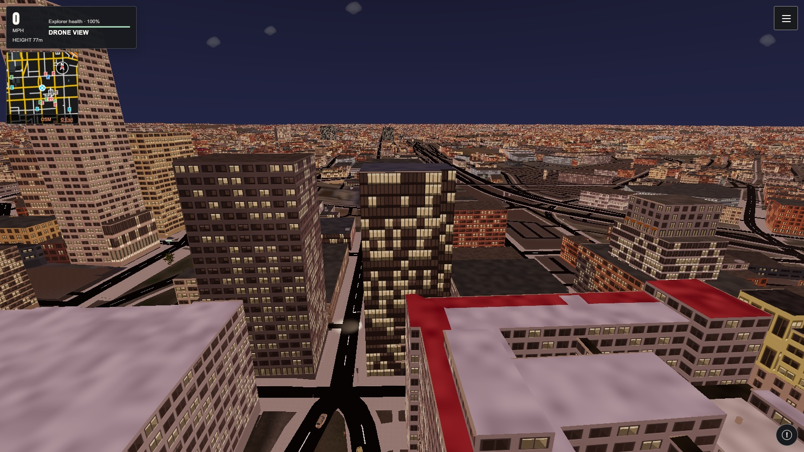

*The city view shows 5.7. Additional gameplay scenes were captured in 5.6.*

| Explore on foot | Drive the city |
| :--: | :--: |
| 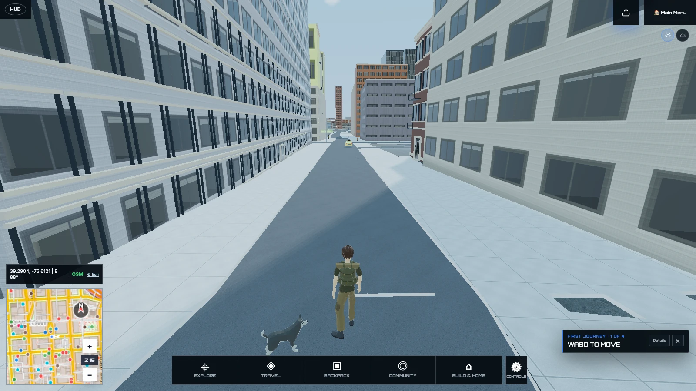 | 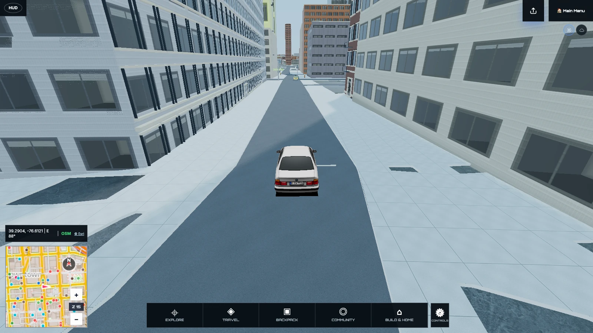 |

| Take flight | Your research vessel |
| :--: | :--: |
| 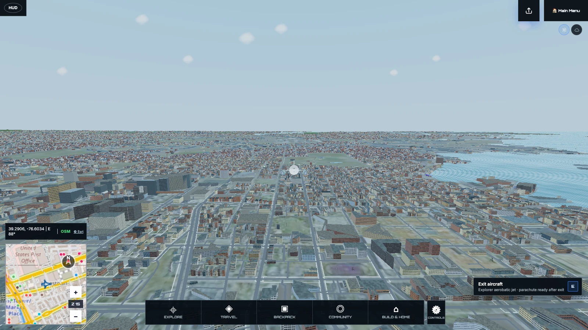 | 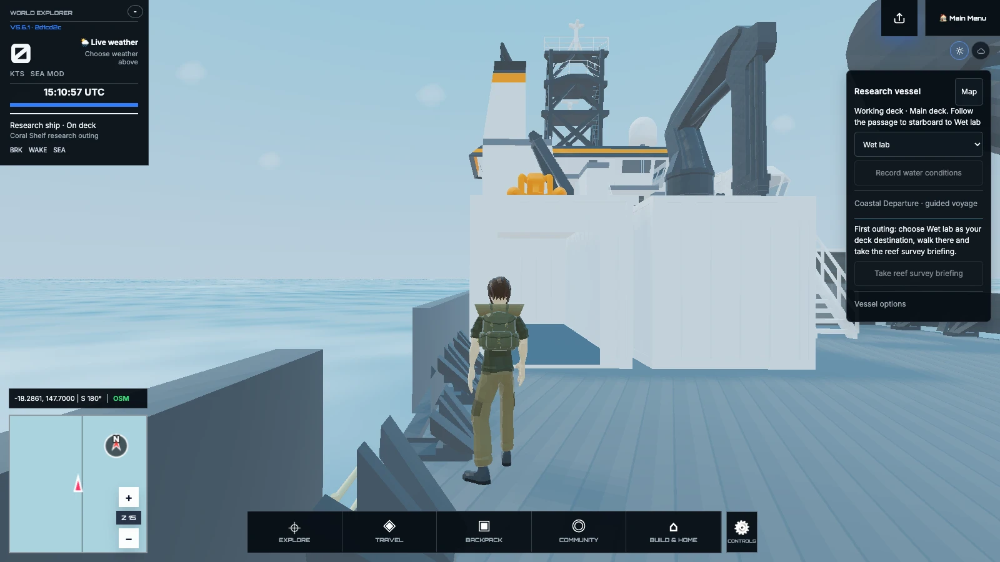 |

| Below the surface | Aboard Solis Reach |
| :--: | :--: |
| 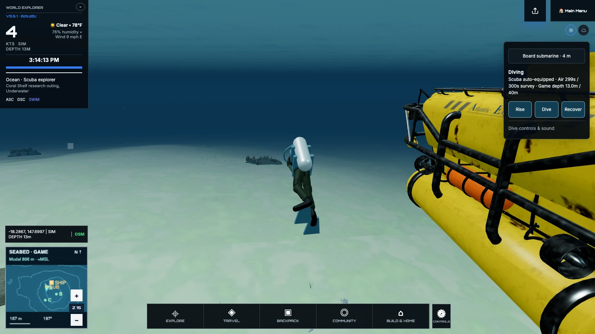 | 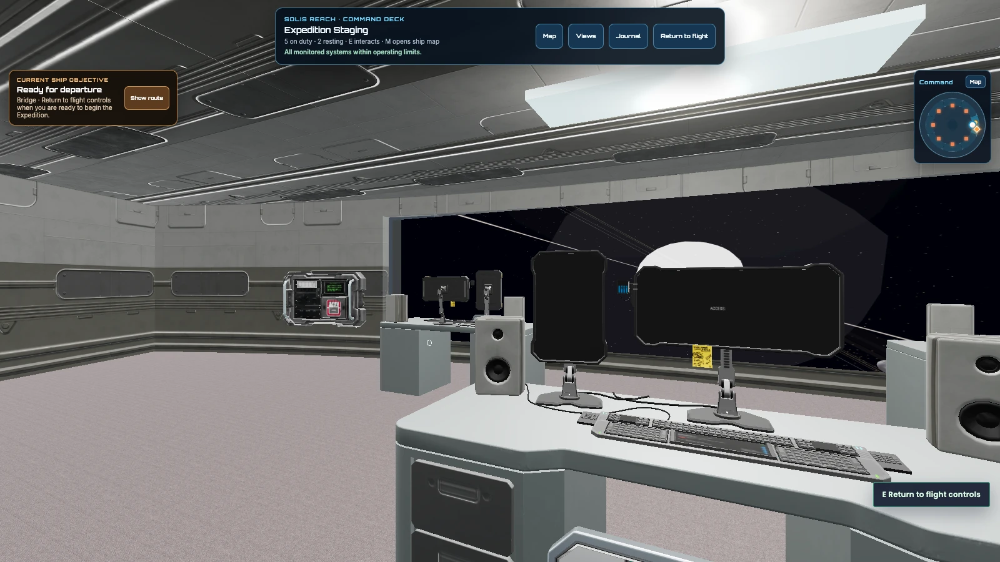 |

| Beyond Earth | Live Earth |
| :--: | :--: |
| 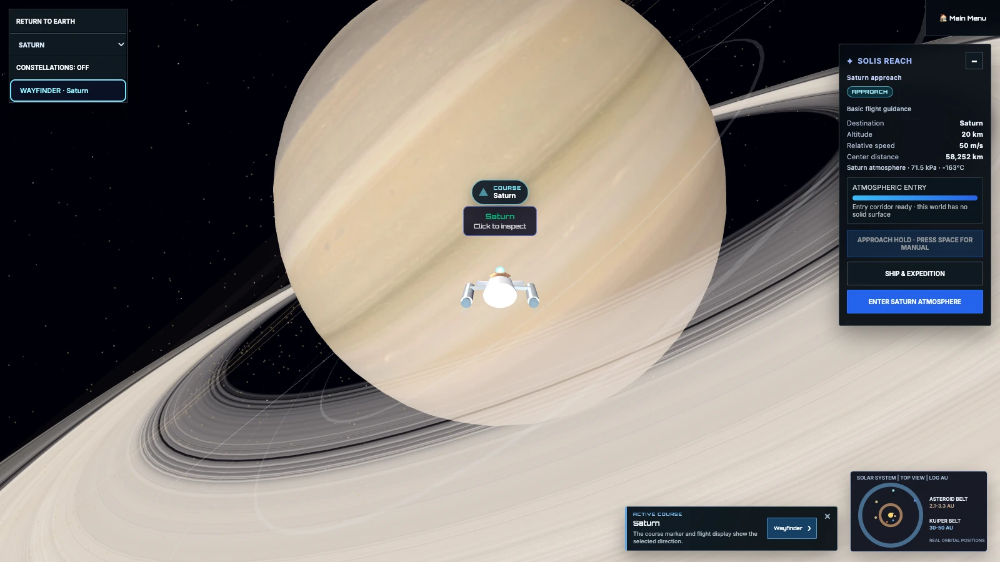 | 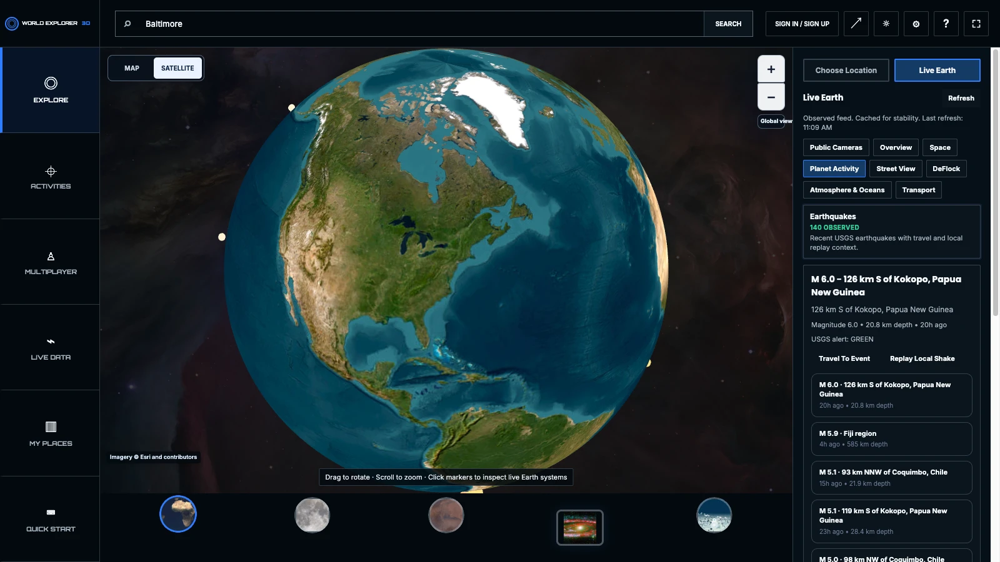 |

| Below the waterline | A collection to explore |
| :--: | :--: |
| 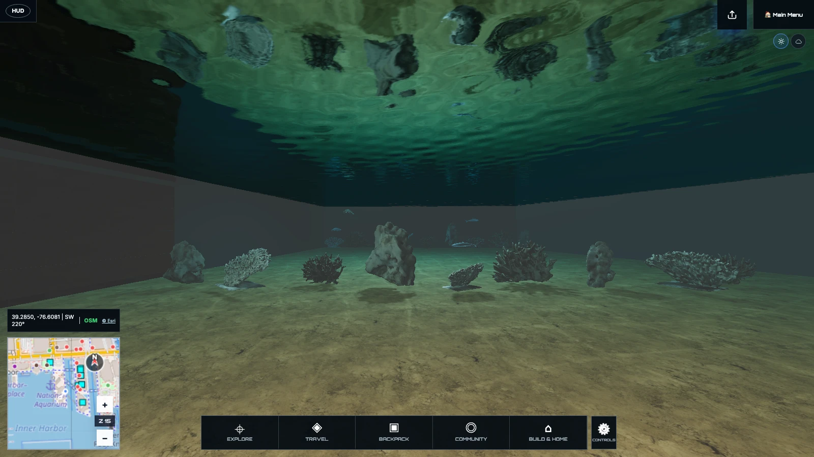 | 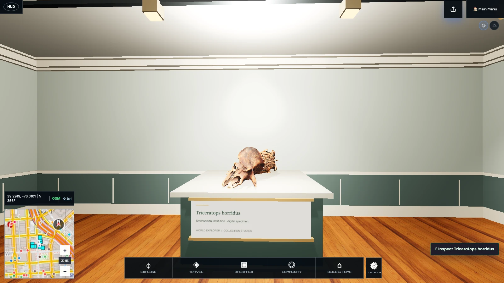 |
<!-- public-gallery:end -->

## What you can do

- Explore on foot, by car, drone, plane, helicopter, boat, ship, rover,
  astronaut on solid planetary surfaces, or spacecraft; or use optional Live
  GPS play while walking.
- Drive vehicle families with distinct vehicle handling, visible condition, and
  enterable responder vehicles.
- Visit supported mapped airports to board aircraft, choose pilot or passenger
  travel, search for destinations, or take a local sightseeing flight.
- Search for places by familiar names, including cities, landmarks, airports,
  and other expected location searches.
- Enter supported buildings to explore their interiors.
- Enter the National Aquarium’s Pavilion and Blacktip Reef visitor route,
  take the lifts between viewing levels, and record marine-life observations.
- Visit the interpretive gallery at The Peale's mapped Baltimore building,
  inspect Smithsonian and Met reproductions, and save collection notes.
- Use configurable Backpack quick slots for field tools, fishing gear,
  equipment, and ranged actions.
- Photograph, inspect, survey, identify, fish, follow tracks and signs, and
  record finds in the Journal and Field Guide.
- Explore eleven regional Field Guide packs with 180 attainable entries across
  the built-in Earth destinations.
- Care for companions, build trust and levels, and travel with eligible
  domestic, bird, and livestock companions.
- Enter persistent multiplayer rooms with presence, chat, activities, shared
  Blocks, and room vehicles.
- Use Quick Build to place persistent Blocks in local play or a multiplayer
  room.
- Leave Earth for the Moon, planets, the solar system, and selected deep-space
  destinations, with manual flight always available.
- Try Interstellar Expeditions in Alpha: live aboard Solis Reach, work with its
  crew, respond to voyage events, and fly Pathfinder to supported planetary
  sites and back.
- Claim a first virtual property, list or purchase available properties with
  Explorer Credits, and connect planetary samples to the same Backpack, cargo,
  and mapped-business exchange loop.

## Explore the ocean

Start an ocean outing aboard the research vessel. Explore its enclosed wet and
dry labs, galley, mess, quarters and bridge, using the deck map to find your way.
Walk, run and jump aboard, enter the water, swim with automatic dive equipment,
or deploy the submarine and recover to the same ship.

Personal geographic voyages can stream nearby ocean scenery as you travel, with
an option to keep a fixed area. Authored research outings and shared crew surveys
remain separate. Available depth and habitat information constrain marine life;
virtual wildlife sightings are not live reports of real animals.

Follow First Bearings into fieldwork, a Harbor Run delivery, a three-view photo
study or a personal workspace. Coastal research and lunar fieldwork connect new
records to your existing Journal. Free roam remains available throughout.

## Beyond Earth

Fly manually or use optional Wayfinder assistance. Interstellar Expeditions
Alpha connects life aboard Solis Reach, planetary fieldwork, Pathfinder travel
and saved voyage progression. Ship art, crew motion, mission variety, sound and
planetary detail continue to develop.

## Multiplayer and building

Multiplayer uses bounded rooms rather than one continuous MMO world. A room
shares one location, player presence, chat, activities, persistent vehicles,
and player-built Blocks. Private rooms use invite codes; public rooms can be
found by city.

Quick Build places persistent Blocks in the current location. Local builds stay
on your device; room builds can be shared with other signed-in explorers.

## World data and accuracy

Earth scenes use OpenStreetMap-derived geometry and other attributed public or
licensed sources. Coverage, freshness, height information, and provider
availability vary by location. Mapped, observed, modeled, reference, and
game-created content stay visibly distinct.

World Explorer 3D is a game. It is not a navigation, appraisal, surveying,
wildlife-presence, or safety service.

- [Data sources](DATA_SOURCES.md)
- [Attribution](ATTRIBUTION.md)
- [Known issues](KNOWN_ISSUES.md)
- [Acknowledgements](ACKNOWLEDGEMENTS.md)

Required map attribution: `© OpenStreetMap contributors`

## Install on your device

The full web app runs on supported phones, tablets and computers. Use
[installation and downloads](https://worldexplorer3d.io/about/download.html) for
browser installation and the signed Android APK. Google Play is in testing;
the iPhone and iPad App Store edition is being prepared.

## Playing in your browser

Keyboard and touch controls support browser zoom, visible focus, higher
contrast, larger text, and reduced motion. A desktop browser is recommended
for large city scenes. Online rooms and cloud features require sign-in;
exploring on your own does not.

For setup and contributions, see [Contributing](CONTRIBUTING.md).

## More about the project

- [What is new in the 5.7 preview](RELEASE_NOTES_5.7.0.md)
- [Previous release: 5.6.1](RELEASE_NOTES_5.6.1.md)
- [Changelog](CHANGELOG.md)
- [Roadmap](ROADMAP.md)
- [Controls](CONTROLS_REFERENCE.md)
- [Contributing](CONTRIBUTING.md)
- [Security policy](SECURITY.md)

## License

Copyright © 2026 Steven Reid / World Explorer 3D. All Rights Reserved.

This repository is publicly viewable under the custom source-available terms
in [LICENSE](LICENSE). It is not licensed as OSI open-source software, and
attribution alone does not grant permission to copy, redistribute, publish,
host, or create derivative works. Third-party data, software, and assets remain
subject to their respective terms in [ATTRIBUTION.md](ATTRIBUTION.md) and
[ACKNOWLEDGEMENTS.md](ACKNOWLEDGEMENTS.md).
