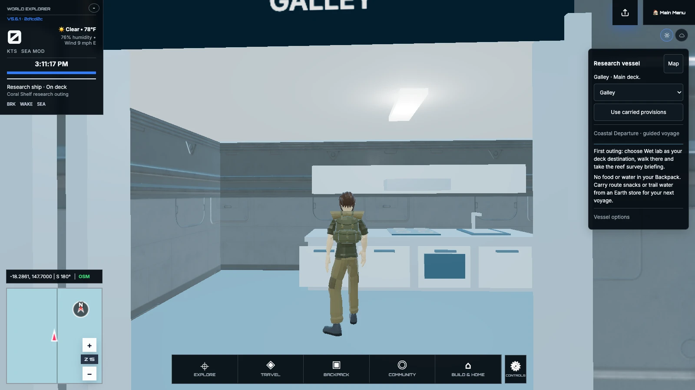
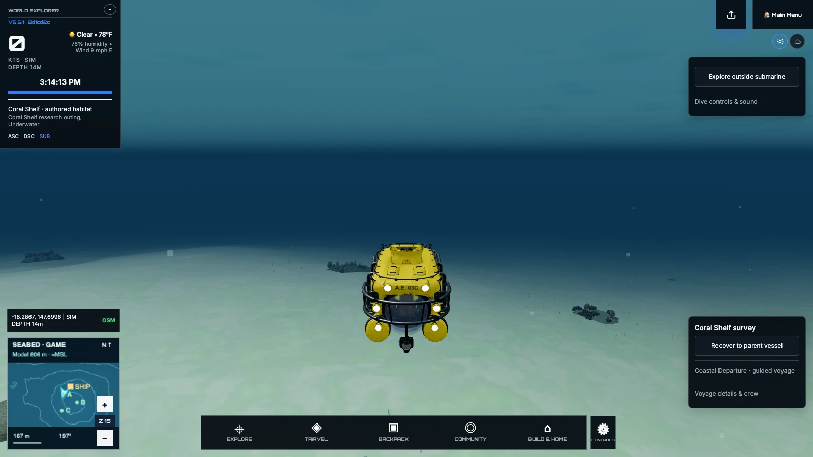
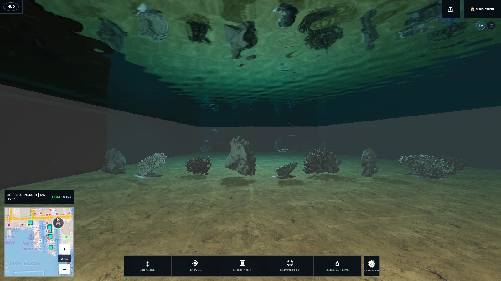
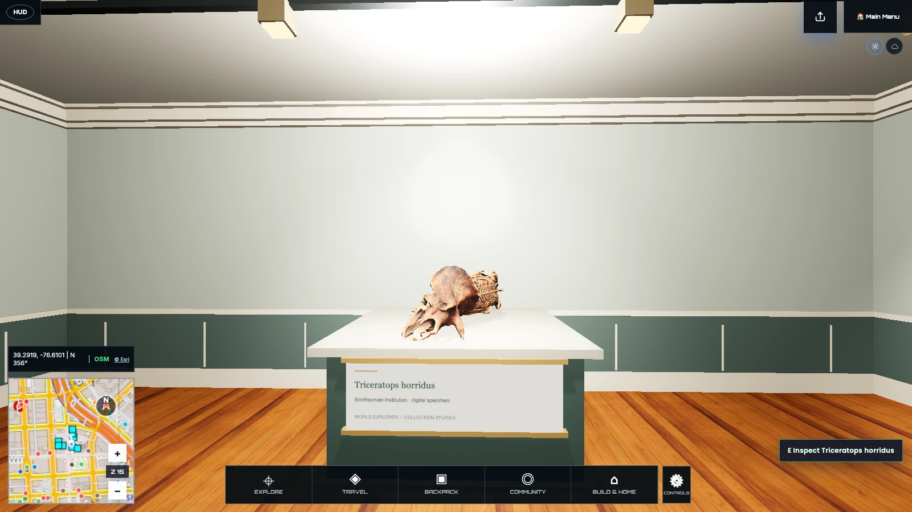

# Closer to the places you explore

World Explorer 3D 5.6.1 connects more of the journey: first discoveries, a place
to work, a research ship and exploration beyond the starting area. Your existing
locations, Backpack and Journal stay part of the same game.

## Connected streets and familiar places

Road detail recovers where you are, without sending you back to Main Menu.
Side streets join graded approaches at a shared driving height. Earth opens
with the selected location; extending scenery beyond it is an optional setting.

Memory handling and scene cleanup have been improved for repeated travel and
location changes. Existing mapped coverage and player progress are preserved.

Baltimore’s aquarium and The Peale have repaired street entrances and more
recognizable exteriors. Harbor walls contain the waterfront, and a smaller
passenger launch fits the harbor. At Kennedy Space Center, explore the VAB
ground floor and the mapped LC39B launch-pad area.

## Start with a purpose

First Bearings helps you choose a field interest, follow a nearby lead and review
your first finding. Continue with a Harbor Run delivery, a three-view study of a
building or a personal research workspace. Completed work earns the corresponding
Journal records and distinctions; free roam remains available.

Coastal research links a voyage plan, sonar contacts, diving and a report aboard
your vessel. Lunar fieldwork lets you prepare a method, deploy Pathfinder, work
on the surface and bring your results back. Your findings become part of the
same Journal as your discoveries on Earth.

## Life aboard the research vessel

A new research vessel and submarine replace the earlier models.
Walk through the wet lab, dry lab, galley, mess, quarters and wheelhouse. Connected
stairs and a deck map help you find the room you need. Stations use the existing
Journal, provisions and voyage systems.

Deck walking now includes running, jumping and mouse look. The camera follows
stairs smoothly while feet retain physical contact with the steps. Enter the
water, swim or dive with the appropriate equipment, deploy the submarine and
recover to the same parent ship.

<!-- public-gallery:research-interior -->

## Explore farther

Personal geographic ocean voyages can load nearby seabed scenery while releasing
the area left behind. Depth follows the selected area, and your vessel and saved voyage
stay connected as you travel. A setting keeps the original fixed-area behavior available. Authored
study sites and shared crew voyages retain their own boundaries.

Regional Earth buildings retain more facade and roof detail during travel.
Terrain imagery now follows the traveling region too. Failed requests retain the
last complete scenery while recovery proceeds. Existing selected-location roads,
buildings and land-cover detail are preserved.

Selected fish and dolphins use location and depth rules. Wildlife
observations belong to the game Journal and are clearly distinguished from real
animal sightings. The Journal and Field Guide remain available across ocean and
planetary journeys, with supported return actions for saved voyages.

<!-- public-gallery:submarine -->

## Step inside

Enter the National Aquarium from Baltimore’s waterfront and follow the Pavilion
route to Blacktip Reef. Lifts connect the upper view and the gallery below the
waterline. Watch sharks and a sea turtle among the coral, look up through the
water, and save observations in your Journal. The visitor map helps you find
another level and return outside.

<!-- public-gallery:aquarium -->

A separate museum visit opens at The Peale’s mapped building. Its entrance hall
and two galleries contain Smithsonian specimen models and a Met artwork to
inspect, with collection notes saved to the same Journal.

<!-- public-gallery:museum -->

## Clearer presentation and progress

Return to Earth now clears the previous flight course before descent. Clicking
inside a venue no longer selects outdoor buildings through its walls. The ocean
travel setting sits beside the regional scenery option in Graphics.

The BMW uses a lighter authored finish, and consistent display color and night
lighting improve character and vehicle visibility. Supported facilities retain
mapped fences, gates and transfer behavior. Your local building edits, shared-room creations, possessions and saved voyages
remain available when you return.

Existing progress and recovery copies are retained when you update. See the
[known issues and limitations](KNOWN_ISSUES.md) for current coverage and
compatibility, or the [roadmap](ROADMAP.md) for what comes next.
