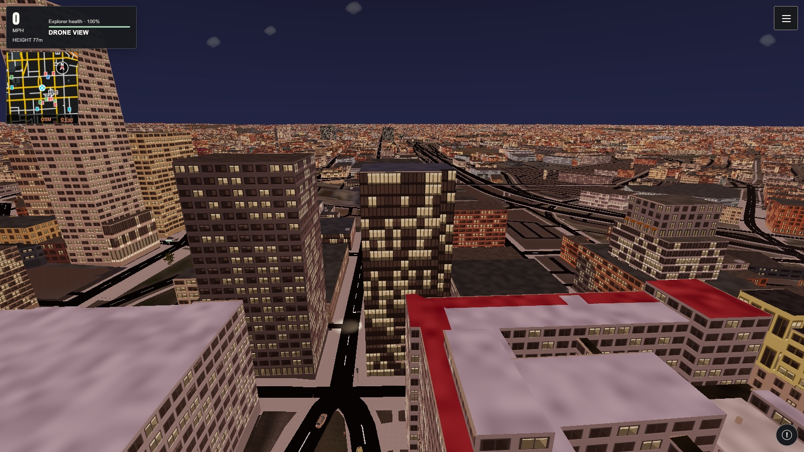

# World Explorer 3D 5.7 — Careers, homes and a fresh start

**Choose a starting place. Create your explorer. See where it takes you.**

5.7 gives World Explorer a clearer beginning and more reasons to return. Choose your character and first car, follow a career or explore freely, find a home, and keep your discoveries together in your Journal. Your supported personal progress can continue on another device when you sign in and save it to your account.

> **Public preview:** Try 5.7 while building improvements and remaining compatibility checks continue. This release does not update the live production game. The newer interior overhaul is still in development and is not included in this preview.

**[Try the 5.7 preview](https://we3d-staging-20260712.web.app/app/)** · [Play the live game](https://worldexplorer3d.io/app/) · [Known issues](#known-issues-and-work-in-progress) · [Report a problem](#help-improve-the-preview)

<!-- public-gallery:drone -->

*Baltimore, explored from above in the game.*

## What's new in 5.7

- **A fresh interface and a guided start.** Create your explorer, choose a first car and set out with a career or free exploration.
- **Nineteen available careers.** Saved assignments, field reports, achievements and a clear next step bring your interests into the same journey.
- **A home to return to.** Find a starter home, keep its exact location and return after exploring elsewhere.
- **Personal saves across devices.** Sign in to carry supported career records, Journal, equipment, home and exploration progress between devices.
- **A quieter gameplay screen.** Extra options move into a menu, the globe has more space, and loading screens explain useful shortcuts.
- **Faster return to your current city.** Reopening the location already loaded in your session reuses the world instead of rebuilding it.

This is the cumulative 5.7 overview since the last numbered release, **5.6.1**. The racing features below first went live in the October 31 update and remain part of 5.7.

## Start anywhere, go your own way

The interactive globe remains the starting point for choosing a place. Search for a city, landmark, airport or coordinates, select a point on Earth, or choose the Moon, Mars, Ocean or Space. Free exploration is available from the beginning.

The new introduction takes you through your explorer, career choice, first car and departure. Available careers appear first; unfinished choices are marked **Coming soon**. You can change interests later without discarding the assignment you left behind.

| Choose your place | Choose your first car |
| :--: | :--: |
|  |  |

## Careers with a next step

Careers now share a place in Activities and your personal journey. Open an assignment, review its stages, carry out the work and return to your saved result. Journal records and achievements remain available when you move to another interest.

The work differs by career. Geology asks you to compare rock exposures and samples. Archaeology follows objects in their layers and locations. Oceanography takes you between coastal stations and the research ship. Racing connects preparation, clean finishes and your race record. These are playable courses and follow-on studies; campaign length and depth vary by path.

*Compare evidence and save a conclusion. This fieldwork capture shows the earlier interface used before the 5.7 redesign.*

<strong>Explore all 19 available careers</strong>

| Career | Opening assignment | What you do |
| :-- | :-- | :-- |
| Racer | First clean finish | Prepare a car, finish cleanly and build a race record. |
| Geologist | Reading the Landscape | Compare rock exposures, samples and their formation. |
| Archaeologist | A Place in Context | Survey a training site and interpret finds in context. |
| Mining engineer | From Vein to Material | Survey a virtual quarry, work a supported face and restore the site. |
| Palaeontologist | The Fossil Bed | Record, prepare and compare a fossil. |
| Oceanographer | Across the Water Column | Compare coastal stations, survey the seabed and return to the research ship. |
| Marine biologist | Life Along the Slope | Observe marine life and compare habitats. |
| Wildlife ecologist | Two Habitats | Make comparable observations in different habitats. |
| Botanist | A Living Patch | Study plant structures and follow a virtual restoration plot. |
| Hydrologist | Following the Water | Measure stream stations and investigate a catchment. |
| Meteorologist | Reading the Sky | Compare weather stations and test a forecast. |
| Cartographer | Make the Route Usable | Measure a route, review access and prepare a route sheet. |
| Planetary scientist | Two Sides of the Moon | Compare lunar sites and bring observations home. |
| Astronomer | A Night's Observing | Align an instrument and keep an observing log. |
| Accelerator scientist | Collision Lab | Steer beams, inspect detector measurements and study collisions. |
| Field engineer | Make a Useful Place | Diagnose a need, build or repair, then test the result. |
| Documentary explorer | A Place in Three Views | Make contrasting photographs and a saved album. |
| Explorer | First Bearings | Record a discovery and choose the next journey. |
| Companion handler | Exploring Together | Care for a companion, build trust and develop field skills. |

**Expedition pilot is coming soon.** Free flight remains available, and Harbor Run continues as a road-delivery activity.

## Make a home and keep your progress

Your journey brings character setup, the garage, home and first discoveries into one place. Visit a mapped home, review its price and buy it with your personal Explorer Credits. Its saved location gives you somewhere familiar to return to after another outing.

Signed-in players can save their supported personal journey to their account and restore it on another device. When devices have different progress, the save controls let you choose which version to keep and retain recovery copies. Guest progress stays in that browser, with backup and restore available.

Before switching devices, check that your account save is current. Keep a backup of guest progress, especially when trying a preview build. Online race results, shared property and multiplayer continue to use their existing account services.

## Racing: real cars, three venues, your own tracks

Silverstone's GP loop and pit lane, the Nordschleife T13 layout, and Daytona's tri-oval and pit branch are included. Prepare a **BMW M3 E46**, **BMW M3 E92 race car** or **Porsche 911 Carrera 4S** through the garage, with upgrades and vehicle condition carried through the race.

The racing update repaired driving and camera interpolation and connected barrier impacts to vehicle damage and handling. Condition returns with the car to the garage. Rivals, crews, shared races and comparable leaderboard classes remain connected to your race record.

The track creator offers three ways to make a course:

1. Select connected roads on the overhead map.
2. Drive a route, then use **Finish & edit** to clean up the layout.
3. Mark a circuit on supported open ground where there are no roads.

Preview the course, edit its shape, test it, then save it or share it with your current room. Track highlights and event barriers define the route. Room-created tracks are unranked and do not award competitive Credits; reviewed public events retain their separate rankings and reward rules.

*The track creator, captured in the October racing update before the new interface.*

[Read the racing guide](https://github.com/RRG314/WorldExplorer3D/blob/stable/RELEASE_NOTES_RACING.md).

## From familiar streets to other worlds

The new beginning sits above the existing sandbox. Walking, driving, flight, sailing, diving, building, companions, multiplayer and space travel remain available. Detailed Earth streets and activities load around your selected location; optional traveling scenery extends terrain and mapped buildings as you move farther away.

| The Moon | Mars |
| :--: | :--: |
|  |  |

| Ocean exploration | The Solar System |
| :--: | :--: |
|  |  |

Ocean outings connect deck exploration, diving, submarine deployment and a return to the research vessel. Space offers manual flight, optional Wayfinder assistance and supported planetary surfaces. **Interstellar Expeditions remains an optional Alpha:** live aboard Solis Reach, work with its crew and take Pathfinder to supported field sites and back.

| Aboard the research vessel | Inside Solis Reach |
| :--: | :--: |
|  |  |

*These two carried-forward ship scenes show the earlier interface.*

Baltimore's existing venue visits remain available: the National Aquarium's limited Blacktip Reef route and an interpretive front-ground-floor gallery at The Peale. The museum displays Smithsonian and Met reproductions, rather than The Peale's own collection. Further venue expansion is still in development.

| Below the aquarium waterline | The interpretive museum gallery |
| :--: | :--: |
|  |  |

*Existing venue gameplay, captured before the interface redesign. These images do not show the unfinished venue expansion.*

## Controls and everyday improvements

- More of the world stays visible while playing. Secondary options are available through the gameplay menu.
- The globe has a larger usable view, with credits and secondary information moved out of its working area.
- Mobile layouts, enlarged text and keyboard focus have been revised; performance still depends on the device.
- Loading-screen hints introduce useful shortcuts. The full [controls reference](https://github.com/RRG314/WorldExplorer3D/blob/stable/CONTROLS_REFERENCE.md) covers travel and world-specific actions.
- Reopening the city already loaded in the same session avoids a full rebuild. New places, browser restarts and unavailable map services can still require longer loads.

## Known issues and work in progress

| Area | Current limitation / next work |
| :-- | :-- |
| Buildings and interiors | Room detail, layouts, stair openings, lifts, furniture scale and facade flicker need further work. The newer interior overhaul is not part of this preview. |
| Museum and aquarium | The playable visits cover limited routes. Full venue layouts, all exhibitions and more detailed displays are still being developed. |
| Loading and performance | Dense cities and detailed scenes can load slowly or pause, especially on devices with little memory. Faster same-session return does not eliminate first-load costs. |
| Careers | Nineteen paths have playable assignments; depth varies. Expedition pilot is disabled as Coming soon. |
| Ocean and deep space | Wildlife coverage, crew animation, mission variety, room art and sound remain uneven. Interstellar Expeditions is still Alpha. |
| Phones and VR | Touch layouts are available. Wider testing of physical phones, Safari, heat, battery use, resume and headsets remains necessary. |
| Map data and services | Road, building, height and indoor data vary by location. Provider outages can delay search or scenery. |
| App stores | Google Play is in closed testing. The iPhone/iPad App Store edition is being prepared and is not publicly available yet. |

[Full known issues and limitations](https://github.com/RRG314/WorldExplorer3D/blob/stable/KNOWN_ISSUES.md).

## Play and download

| Option | Availability |
| :-- | :-- |
| **5.7 browser preview** | [Open the staging version](https://we3d-staging-20260712.web.app/app/). This is the recommended way to try the features in these notes. |
| **Live browser game** | [Play World Explorer 3D](https://worldexplorer3d.io/app/). Production is updated separately. |
| **Install the web app** | Use the browser's install or Add to Home Screen option on supported devices. [Installation help](https://worldexplorer3d.io/about/download.html). |
| **Android launcher** | The signed [5.7.0 APK](https://github.com/RRG314/WorldExplorer3D/releases/download/v5.7.0-preview.1/world-explorer-5.7.0.apk) is attached below. It opens the live hosted game; it does not switch that service to the 5.7 staging preview. Google Play access is through the closed test. |
| **iPhone and iPad** | The web app is available now. The separate App Store edition is in preparation. |
| **Source** | GitHub supplies source archives for this preview tag. Use the APK to install the Android launcher; the source archives are for development. |

An internet connection is required. APK users can check the file against the attached [SHA256SUMS](https://github.com/RRG314/WorldExplorer3D/releases/download/v5.7.0-preview.1/SHA256SUMS). An Android App Bundle is a store-publishing file and is not offered as a direct installation download.

## Help improve the preview

[Report a bug](https://github.com/RRG314/WorldExplorer3D/issues/new). Include your browser and device, the place or world, the action you were taking, what you expected and what happened. A screenshot or short recording helps. Keep passwords, account emails and private room codes out of public reports.

[Changes since 5.6.1](https://github.com/RRG314/WorldExplorer3D/compare/v5.6.1...v5.7.0-preview.1) · [Changes since the racing update](https://github.com/RRG314/WorldExplorer3D/compare/production-racing-2026-10-31...v5.7.0-preview.1) · [Changelog](https://github.com/RRG314/WorldExplorer3D/blob/stable/CHANGELOG.md) · [Data and asset credits](https://github.com/RRG314/WorldExplorer3D/blob/stable/ATTRIBUTION.md)
