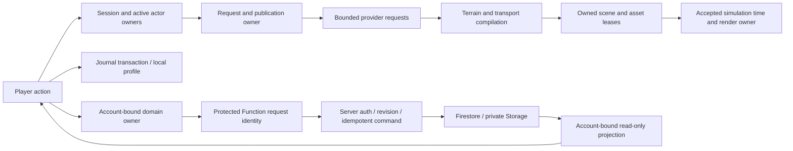

# Authority, dependencies and lifecycle

This map distinguishes canonical rules from remaining compatibility writers. It does not certify that every feature already obeys a single-writer architecture.

## Critical state owners

| Domain | Canonical commands / observations | Writes, time, lifecycle and boundary |
| --- | --- | --- |
| Authenticated identity | `js/auth-ui.js`: `getCurrentUser`; Firebase Auth listener | Firebase owns identity. Account request captures UID before the first await; stale results and routing continuations cannot confirm another account. Server still verifies its token. |
| Wallet | `functions/economy-authority.js` transactions; `connected-wallet-authority.js` transact/settle/snapshot | Server owns credits. `economy/wallet-snapshot.js` owns current/legacy display conversion. Property consumes the shared wallet or its compatible own subscription to the same projection. No balance write moved client-side. |
| Commerce intent / delivery | `economy/connected-commerce-recovery.js`; existing Backpack Web Lock and delivery envelope | One pending command per UID is saved before dispatch. Server receipt owns charges; Backpack owns atomic delivery and its marker. Unknown outcome retains the original command. Old unowned receipts are preserved for authenticated reconciliation. |
| Companions / care | `discovery/companion-runtime.js` → profile-store transaction | Care mutates the latest stored companion; explicit recipient pins service XP across selection changes. Idempotent receipts prevent duplicate XP; failed saves do not settle a funded service as complete. |
| Water ownership mask | `terrain/canvas-red-mask.js` and disposable worker | Existing rasterization stays authoritative. Transferable bitmap/readback produce byte-identical mask; failure falls back cooperatively. Worker and bitmap have bounded owned lifetimes; final region handoff is unchanged. |
| Properties / trades | `functions/property-authority.js`; `connected-property-authority.js` buy/list/rent/trade | Account, catalog, revision/receipt and server transactions decide ownership. Stale client owner rejects commands and subscription callbacks. Existing local personal-home store remains separate. |
| Condition | `player/condition-sync.js`, transactional `condition-outbox.js`, connected player state | Client owns simulated condition; server owns acknowledged revision. Pending/uncertain intent is durable per account. Dispose does not overwrite another tab's intent. Not anti-cheat simulation. |
| Local progress | `discovery/profile-store.js`, `journal-index.js`, Backpack projection | Journal v5 owns authoritative original rows and atomic derived indexes; read/write transactions and backup retain unknown fields. Existing Journal schema retained. C5 adds a per-account pending-commerce journal and an additive delivery marker in the existing Backpack envelope; no destructive migration. |
| Earth publication | `world/load-runtime-session.js`, load request/session, `earth-core/world-readiness.js` | Validate before destructive reset. Only matching committed publication can restore pose/start play. Session drains provider work and rejects stale completion. Regional scenery has distinct ownership. |
| Coordinates / surfaces | `earth-core/coordinate-frame.js`, committed origin, `world/road-units.js`, `SurfaceQuery` | Lat/lon degrees, provider meters and local x/y/z must convert through these owners. Geometry, collision and actor support share final surfaces; no arbitrary scene transform becomes geographic truth. |
| Transport profiles / tunnels | Transport surface compiler and `tunnel-envelope.js`; structure façade | Envelope owns pure clearance/bound queries; obstruction builder consumes completed surface sampling. Legacy obstruction query reexports the same function. The compiler no longer imports its higher-level obstruction builder. |
| Environment | `session-coordinator.js`: begin/commit/cancel and `captureEnvironmentSession` | Generation, environment, world sequence and abort signal fence async work. Concrete environment adapters retain rollback and release duties. Shared context remains compatibility access, not an independent owner. |
| Simulation time | `runtime/simulation-clock.js`, `runtime/kernel.js`, Ocean/Space adapters | Accepted elapsed delta bounded to fixed-step capacity; pause/hidden/unready accepts zero. Raw frame time stays in diagnostics. Server lease time and provider timestamps are independent wall clocks. |
| Actor / camera | `travel-mode.js`, active mode physics, `transport/actor-contract.js`, mode camera owners | 18 direct car writers, 13 walker writers and 10 camera writers remain in baseline. These include bootstrap, reset, pose restoration and physics. No claim of fully encapsulated actor state. |
| Render / asset lifetime | Active Earth/Ocean/Space adapter; engine scene/WebGL lifecycle and asset leases | Retire scene objects through their resource owner; shared templates release at final lease. Application-lifetime listeners must not be mistaken for world leaks. GPU memory is not equal to JS heap or Three counters. |
| Personal marine voyage | `ocean/voyage-store.js`, voyage/context and streaming owners | v1/v2/v3 readers and conflict rejection; parent ship/sub identity, geo/depth and mode separate from renderer. Existing keys preserved. Shared voyages never write the personal record. |
| Shared marine / expedition | Marine server authority, client reliable command and replaceable pose transport; generated Expedition command engine | Membership, exclusive lease, server-relative time, idempotent revisions. Stale generation cannot enter a new scene. Server physics remains a bounded envelope, not complete underwater collision. |
| Room state / creation | Room admission, shared block/vehicle owners, Firestore rules | Server/membership and ownership checks govern room operations. Presence is client presentation, not proof of valid travel. No one-world MMO inferred. |
| Capture / private media | Capture session/draft owner → protected revision/review → storage/privacy authority → runtime placement | Draft, submitted, approved, private grants and derived media remain separate. UI visibility cannot authorize server reads. No raw user records or credentials inspected. |
| Provider evidence | Provider registry and domain refresh owner | Bounded caches, abort leases and freshness; observed/modeled/game content remain distinct. World and Live Earth have separate request lifetimes. |
| Input / UI / pause | Controls/action router; named pause reasons; current panel/environment owner | Restore only the current owner's input. Queued account callbacks now check current identity before notifying property/wallet UI. Other asynchronous UI owners still need case-by-case review. |

## Dependency and event inventory

The baseline graph contains static and literal dynamic import/require edges with source lines, imported-by lists, direct context readers/writers, timers/listeners/subscriptions and empty-catch sites. Events without a literal name are explicitly `null`; no semantic event name is invented. `config/context-write-allowlist.json` complements the direct-import scan with injected/aliased writes. Neither tool proves transitive mutation or reflective reachability.

A static cycle was found and repaired in C3. Runtime cycles remain possible through the context and callbacks even when static cycles are zero. In particular, UI → authority → onChange → UI must fence identity and avoid reentrant writes. `onSnapshot` is a projection; it is not permission to resend a mutation. Dispose must unsubscribe even if the account has already changed.

## Recheck of earlier findings against current code

| Earlier finding | Current disposition and exact evidence |
| --- | --- |
| F01 marine backlog / wrong clock | FIXED for demonstrated case: shared marine transport coalesces motion and uses server-relative lease state; the shared-marine transport tests selected by `scripts/verification/current-contract-list.mjs`. Current shared-marine runtime checks generation/stage after awaits and catches up a replaced stage. Broad adverse-network gameplay remains unverified here. |
| F02 stale condition overwrite | FIXED for demonstrated case: `player/condition-sync.js` queues durable latest intent and preserves uncertain dispatch in `condition-outbox.js`; condition-sync/current backend tests and earlier two-tab browser receipt. No new claim about all account stores. C1 found the analogous missing identity fencing in wallet/property. |
| F03 timing divergence | FIXED for accepted-time/camera rules: kernel uses `acceptedSimulationDelta`; camera/clock tests run in the source suite. Actual pauses remain STILL_PRESENT. |
| F04 shared context | STILL_PRESENT: 167 direct importers / 121 direct writers / 1,147 members; broader alias guard remains. Migrate demonstrated conflicts rather than flattening all state at once. |
| F05 transition lifetime | PARTIALLY_FIXED: environment capture plus marine generation/current-stage checks exist. Not every asynchronous UI path has an audited lifetime. |
| F06 performance gate omission | FIXED: `performance-retention.mjs` now requires `mode.hitches.passed` and mode budgets. Product failures remain failures; no thresholds changed. |
| F07 evidence/environment identity | PARTIALLY_FIXED: runtime/test/environment receipt identity and acceptance classes exist; ordinary hosted and device classes still open. Current source checks are not production certification. |
| F08 full-history Journal queries | FIXED at selected boundary: v5 derived `journalOrder` index and bounded query helpers replace hot-path whole-history reads. Backup/export intentionally reads full original records. Existing long-history receipt remains dated evidence. |
| F09 server storage vs gameplay authority | STILL_PRESENT by intentional product boundary: condition and casual results are validated client claims. Server economy/property/leases are different. No competitive integrity promise added. |
| F10 typing/coverage claims | PARTIALLY_FIXED: `verify:pr` invokes boundary types, current contracts and sensitivity. Narrow types and test counts still do not prove whole-game correctness. |
| F11 dependency versions | PARTIALLY_FIXED: local renderer/vendor hashes and complete executable URL inventory checked; browser Firebase remains pinned separately from emulator SDK. No dependency upgrade attempted. |
| F12 support/operations | PARTIALLY_FIXED: bounded `runtime/support-receipt.js` exists and has contracts. No complete production capacity, recovery or observability certification. |
| October 6 A1–A4/A8 load admission / stale readiness / draining / scheduled callbacks | FIXED for tested boundaries in current world-load request, session, consumer and workload-policy tests. Existing invalid-request/retry evidence preserved. |
| October 6 A5/A6/A7 active hitches / unrestricted streaming / shared context | STILL_PRESENT or PARTIALLY_FIXED: scenery streaming now optional, but detailed roads/gameplay still district-bound; GPU/index/GC stalls and distributed actor writes remain. |

The superseded dated documents remain evidence, not another source of present-tense policy.
