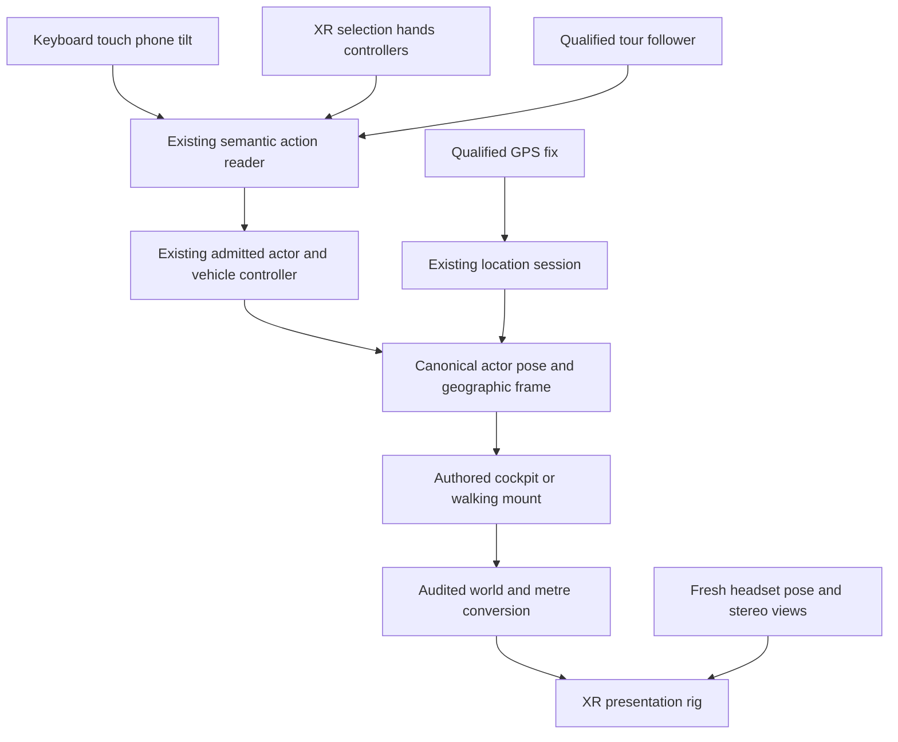

# VR research and architecture for World Explorer 3D

October 25, 2026. Current source: `0b17101` on `steven/mobile-web-controls`.
The tracked worktree was clean before this research. The released game remains
`5.6.1+52d5f246f5ad.25a6fdc42a0cb4c1.production`; Play version 4 remains the
owner-confirmed Android launcher.

## Recommended direction

Build optional headset VR around the existing selected-location game, beginning
with a seated road tour and free head movement. Keep normal desktop, Android
app and phone-browser play, including portrait and landscape. Make the tour a
driver of existing vehicle actions so that manual driving and flying can replace
guidance later without replacing the world, physics or progress systems.

This is technically plausible, but enabling the renderer's XR flag alone would
leave important ownership, scale, input and performance problems unresolved.
First prove a stationary cockpit, stereo scale and one frame owner on a real
headset. Then qualify one short route before expanding to several cities.
Continuous worldwide streaming is not a prerequisite for this experience.

Moving without controller buttons is possible. The first experience should offer
an explicitly started guided ride, hand selection where available, and an
optional head-pointing dwell interface. Actual room-scale walking is another
mode. None of these implies unlimited physical walking or automatic comfort.
GPS can choose the geographic starting area; it must not replace precise headset
tracking.

The sections headed **Proposed** define project decisions and engineering work.
The source findings and component experiment describe what exists now. No world
VR mode, headset qualification, guided road path or deployment was added in this
research checkpoint.

## What the current code supports

| Current evidence | Consequence for VR |
| --- | --- |
| [Runtime kernel](../../app/js/runtime/kernel.js) owns ordered input, simulation, world, camera, presentation and render phases. It exposes `runFrame`, `start` and `stop`. | Keep that kernel. Transfer its frame source between the flat display and XR; do not add a second simulation loop. |
| [Core frame systems](../../app/js/runtime/core-frame-systems.js) use `appCtx.update(frame.dt)` for the main simulation. The kernel also supports fixed updates. | The existing game is not entirely fixed-step physics. Preserve its integration initially and measure cadence effects instead of assuming a 60 Hz simulation already exists everywhere. |
| [Renderer ownership](../../app/js/runtime/renderer-owners.js) distinguishes main, space and ocean renderers. Loading and the existing AR presentation suspend main-world work. | Start with the Earth renderer. Space and ocean require explicit later presentation handoffs. Marking all XR as existing AR would suspend the very world the headset needs. |
| [AR session service](../../app/js/ar/session-service.js) requests `immersive-ar`, uses an isolated presentation and animation loop, and relies on hit testing. [AR admission](../../app/js/ar/eligibility.js) excludes vehicle use. | This is useful lifecycle precedent, not an existing VR vehicle implementation. Preserve its rules; do not turn AR into an unrestricted vehicle entry point. |
| The shipped Three bundle reports revision **128**. Its pinned upstream [WebXRManager](https://github.com/mrdoob/three.js/blob/r128/src/renderers/webxr/WebXRManager.js) contains XR animation and stereo camera support. | WebXR groundwork exists, but modern input examples and renderer APIs cannot be copied into this version without qualification. |
| [Actor contract](../../app/js/transport/actor-contract.js), [control state](../../app/js/transport/control-state.js), [controller registry](../../app/js/transport/controller-registry.js) and [action input](../../app/js/controls/action-input.js) already separate much of command reading from active simulation ownership. | Add XR and guidance as action producers. The current controller must remain the single writer of its vehicle pose. |
| [Session coordinator](../../app/js/session-coordinator.js), [lifecycle scope](../../app/js/runtime/lifecycle-scope.js), [world snapshot](../../app/js/earth-core/world-snapshot.js) and [road leases](../../app/js/terrain/road-region-lease.js) provide generation checks and exact resource retirement. | Reuse those lifetimes. A late permission result, route build or upload cannot adopt a replaced world. |
| [Driving cabin camera](../../app/js/hud/driving-cabin-camera.js) and aircraft camera code write desktop camera position, look direction and up vector. | Reuse authored seat/cockpit facts, but stop those camera writers while XR owns head pose. A desktop chase camera is not a headset mount. |
| [World configuration](../../app/js/config.js) uses 1.11 metres per world unit; [Earth coordinates](../../app/js/earth-core/coordinate-frame.js) preserve the selected geographic frame. | Headset metre units need an explicit, tested presentation conversion. Do not change all gameplay units to make VR appear to fit. |
| [Navigation UI](../../app/js/game/navigation-ui.js) draws a straight line when graph route finding returns no path, then raises visual route points above the surface. | Display navigation is unsuitable as an autopilot trajectory. A tour must reject missing paths and visual offsets. |
| [Traversal](../../app/js/world/traversal.js) already consumes compiled graph node IDs, drive access and direction. It also supports legacy graph provenance and endpoint connectors. | Preserve its semantic information. Tighten tour admission around authoritative, physically supported segments and endpoint connections; do not assume every displayed route is drivable. |
| [GPS runtime](../../app/js/live-gps/runtime.js) filters geographic fixes and moves the flat avatar; its [field authority](../../app/js/live-gps/field-session-authority.js) is foreground-only and does not store raw route history. | Do not let that avatar writer and XR tracked movement both drive an immersed player. Background phone-to-headset GPS is additional work. |

The [October 24 world-mode assessment](2026-10-24-WORLD-MODE-FEASIBILITY.md)
still applies: selected-location gameplay is the foundation; moving scenery and
finite detailed-road residency are not complete worldwide interactive streaming.
The [transport detail planner](../../app/js/terrain/transport-detail-plan.js)
works within supplied selected-area transport. VR must not advertise a larger
physical world than those sources supply.

## Headsets and mobile are different capabilities

WebXR provides an immersive browser path with capability queries, user-authorized
session entry, headset views and tracked input. HTTPS and successful feature
negotiation matter; headset presence or an installed phone app is insufficient.
The current [W3C Device API](https://www.w3.org/TR/webxr/) is a Candidate
Recommendation Draft, not a guarantee that every browser implements every option.

| Target | Research finding | Proposed support path |
| --- | --- | --- |
| Android and iPhone screens | The existing flat phone experience has its own touch, tilt and rotation contract. Headset APIs are an additional capability. | Preserve portrait and landscape, touch fallback and explicit phone sensor permission. Never require XR to play. |
| Meta Quest browser | Meta documents browser-based [WebXR](https://developers.meta.com/vr/documentation/web/webxr-overview/) and [hand input](https://developers.meta.com/vr/documentation/web/webxr-hands/). | Candidate first physical target if no headset is already chosen. Qualify the actual headset/browser rather than promise all Quest generations. Controllers remain a useful accessibility fallback. |
| Apple Vision Pro | [Safari 18 on visionOS 2](https://webkit.org/blog/15865/webkit-features-in-safari-18-0/) introduced immersive VR and transient-pointer interaction. This release statement is specific to visionOS. | Keep input compatible with look-and-pinch, including sources that appear only during a gesture. Qualify this platform separately; iPhone Safari is not equivalent to visionOS. |
| Android XR | Google's [web guidance](https://developer.android.com/develop/xr/web) documents WebXR, stereo output, hand-first input and permission-dependent features. | Capability-driven adapter with separate device acceptance. Ordinary Android phone compatibility does not establish Android XR qualification. |
| Windows with PC VR | Chromium's current [runtime source documentation](https://chromium.googlesource.com/chromium/src/+/main/device/vr/README.md) documents Windows OpenXR integration and its runtime-extension requirement. It does not establish equivalent Mac support. | Later qualification against an identified headset, runtime and browser. The development Mac cannot stand in for this combination. |
| Phone inserted into a simple viewer | Chromium lists a Cardboard backend, but this does not establish full positional tracking or universal phone-browser availability. | Separate future orientation-only capability if useful. Do not present it as equivalent to a tracked headset or depend on it for the first VR release. |

A conventional Google Play phone package does not by itself become a headset
app or a headset-store release. First validate the hosted experience in a
supported headset browser. Packaging and store disclosures follow the actual
chosen platform; [Meta's PWA guidance](https://developers.meta.com/vr/documentation/web/pwa-webxr/)
also calls for browser testing before packaging.

## Framework choice

Meta's current overview recommends its
[Immersive Web SDK](https://developers.meta.com/vr/documentation/iwsdk/guides/overview/).
That framework combines Three rendering with an ECS, lifecycle, input and
optional physics/locomotion systems. It is a serious reference and development
tool option, not a drop-in switch for this game's existing owners.

For this project, start with a narrow WebXR adapter around the current kernel.
Wholesale SDK adoption would require a deliberate ownership migration; running
its world/physics alongside the game's would contradict the existing single
controller and frame contracts. Emulator or isolated input/UI tools can be
evaluated without transferring gameplay ownership. If the first renderer spike
fails, compare the measured repair cost with an explicit renderer/framework or
native-client migration instead of assuming the oldest bundle must last forever.

## Moving without pressing controller buttons

Physical locomotion maps actual movement into VR. Artificial locomotion moves
the virtual body while the physical person stays in place. Vehicle tours are
artificial locomotion even when automatic. Meta's
[locomotion overview](https://developers.meta.com/vr/design/locomotion-types/)
distinguishes physical and artificial methods.

| Method | What the player does | Proposed use and tradeoff |
| --- | --- | --- |
| Guided cruise | Explicitly selects Start, then looks around while the vehicle follows a qualified route. | First seated tour. No continuous button hold. Keep Pause, Resume and Exit available; movement must not begin on headset entry. |
| Hand selection and virtual controls | Uses a pinch/select gesture, or later an authored wheel, lever or throttle. | Controller-free, but not hands-free. Start with discrete selection before attempting sustained hand-wheel driving; tracking loss and arm fatigue need fallback. |
| Head pointing and dwell | A head-centred pointer rests on an intentional control until a progress indicator completes. Looking away cancels. | Optional hands-free Start/Pause and destination selection. Head pointing is not eye tracking. Do not start travel simply because the person looks down or looks at scenery. |
| Latched cruise or auto-walk | Selects movement once, then explicitly stops it or overrides it. | Later independent exploration. Travel heading stays independent of head looking. Pauses and focus loss cancel the latch. |
| Node visits or teleportation | Selects a nearby viewpoint, which becomes the next stationary position. | Lower-motion exploration alternative. Validate destinations through existing walking/surface admission. Never teleport a moving car through the map. |
| Real room-scale walking | Walks within a clear, tracked physical play area. | Natural local inspection. It cannot provide a whole city of safe physical walking in a small room. Respect system boundaries. |
| Walking in place or arm swing | Makes repeated body movements that a detector converts to virtual movement. | Later experiment. Requires reliable stop detection, tracking availability, fatigue and accessibility evaluation. Head bob from sightseeing must not create movement. |
| Voice | Says a supported command with microphone permission. | Optional convenience after platform qualification. Do not make speech recognition the only way to stop; availability, noise and recognition failures vary. |

These controls operate after immersive entry. The browser's initial Enter VR
action still needs recognized user intent/permission; synthetic clicks or an
in-app dwell timer cannot bypass that requirement. Use the platform's supported
hand, controller or accessibility selection for entry. Installed immersive
launch conventions can be considered separately when packaging is selected.

Microsoft's [dwell guidance](https://learn.microsoft.com/en-us/windows/mixed-reality/design/gaze-and-dwell-eyes)
uses an onset delay followed by visible progress, and warns about accidental
activation versus slow interaction. Its example timing is 150–250 ms before
feedback and another 650–850 ms to commit. Those are eye-gaze design examples,
not universal headset requirements. Adapting the staged pattern to head pointing
is a project proposal; its timing needs accessibility and headset checks.

Apple's [natural-input explanation](https://webkit.org/blog/15162/introducing-natural-input-for-webxr-in-apple-vision-pro/)
is particularly important: a transient source appears when a pinch begins and
disappears after it ends. Its initial ray uses the selected gaze direction and
then follows hand motion. It is not a freely available continuous eye-tracking
feed. With hand tracking, useful selecting sources may follow the first two
pose-only sources. Input must follow source identity and event lifetime, not
assume the first two array entries are always controllers.

The 2023 primary study by Banakou and Slater,
[walking in place versus interactive redirected walking](https://www.frontiersin.org/journals/virtual-reality/articles/10.3389/frvir.2023.1294539/full),
found preference/presence depended on physical boundary size. Participant
responses also included unnatural movement, dizziness and interruptions from
turning. It supports investigating alternatives, not declaring one body-motion
method universally comfortable. Do not attempt invisible redirected walking as
a first city-navigation feature.

## Comfort and control choices

Meta's [comfort guidance](https://developers.meta.com/vr/design/locomotion-comfort-usability/)
discusses optic flow, consistent tracking, predictable motion, seated access and
the use of cabins/cockpits to obscure some surrounding motion. These mitigate
specific causes of discomfort; a cockpit or automatic route does not certify
comfort. Its [best practices](https://developers.meta.com/vr/design/locomotion-best-practices/)
also discuss teleportation, snap turning and acceleration exposure.

**Proposed defaults:** begin seated and stationary in a real cabin. Explain the
route and travel method before Start. Offer stationary viewpoint visits for
people who dislike continuous travel. Let the user look freely; do not steer
from head movement by default. Keep travel speed modest, turns predictable and
the route short initially. An optional peripheral vignette can be evaluated
without modifying the headset's optical projection.

Suppress desktop shake, recoil camera kicks, chase-camera easing, forced look
directions and phone gyro camera writes in XR. Preserve fresh tracked head pose
even while simulation is paused. Avoid forcibly levelling the person's head;
any vehicle-horizon comfort option affects the vehicle mount/world relationship
and must be explicit. Flying with banking, steep pitch or aerobatics needs a
separate opt-in and its own comfort qualification.

A short predictable speed transition is not the same as unlimited gentle easing.
Tune acceleration, turn rate and braking together on the headset. A paused or
failed tour should present a stable tracked cabin/lobby rather than freeze the
last head image. Do not require users to tolerate symptoms to finish a test.

## Proposed ownership model



The GPS-to-location connection above is a session/start-area decision for the
first phase. It is not a second per-frame actor writer while a VR vehicle is
active. Each arrow is a read or command boundary, not another global state store.

| Concern | Existing owner retained | Proposed addition |
| --- | --- | --- |
| Environment/world identity | Session coordinator and current world generation | XR presentation lease bound to that session and renderer identity. |
| Time and simulation | Runtime kernel and existing simulation/controller contracts | Select one external frame source for the kernel; retain phase ordering. |
| Vehicle motion | Current admitted transport controller | Manual XR or guided action producer, selected explicitly. |
| Head movement and stereo | Headset runtime through the renderer | XR view adapter; no actor mutation from raw head pose. |
| World source and residency | Current geographic snapshot, road/contact publications and resource leases | Explicit tour residency requirements admitted through those owners. |
| Progress | Current player/progress services | Versioned tour milestone data if introduced; do not save high-frequency head/hand traces. |
| Phone UI and sensors | Current touch/tilt lifecycle and responsive UI | Clear held inputs on presentation handoff; re-evaluate current viewport on return. |

The action reader needs explicit source arbitration: active manual control,
guided travel, and GPS field locomotion cannot simultaneously author movement.
Stop/pause, tracking/focus loss and world invalidation override motion intent.
Manual override cancels guidance through the existing intent/session owner;
it does not create another controller with a competing pose update.

Headset controllers are not ordinary console gamepads. The
[WebXR gamepad module](https://www.w3.org/TR/webxr-gamepads-module-1/) attaches
gamepad data to XR input sources and defines `xr-standard` mapping. The current
`navigator.getGamepads()` reader is therefore insufficient on its own. Use
source profiles, handedness and semantic actions, with events for selection;
never require controller buttons from a hand-only source.

## Proposed session and frame handoff

1. Prepare the bounded world, cockpit and essential shaders. Probe capabilities
   and show Enter VR only when appropriate. Keep ordinary play usable if entry
   is unavailable or denied. Request only required features; hands and overlays
   remain optional, and basic VR does not require camera-image access or GPS.
2. Request the immersive session directly from the user's entry action. Do not
   insert a long asset/network await before the permission request. Capture the
   current session generation and presentation identity.
3. On grant, validate that identity again. End a late obsolete session instead
   of adopting it. Commit the XR renderer/frame lease, clear old movement input,
   and stop the kernel's scheduled flat frame before external callbacks begin.
4. Use the renderer's XR animation callback to drive **one** `kernel.runFrame`
   per delivered XR frame. Render the headset's views through the renderer.
   Never simulate once per eye or run a second independent world update.
5. On focus/pose loss, cancel motion intent and pause simulation. Continue
   tracked presentation when the runtime supplies valid poses. On a reference
   space reset, pause artificial travel and recalibrate the local mount before
   resuming; do not apply a GPS jump to the camera.
6. On exit, replacement or failure, revoke the callback lease, remove owned
   listeners and overlays, release XR-owned resources, and restore the current
   flat presentation. Reset frame timing. Recompute canvas and UI bounds from
   the **current** portrait/landscape viewport; clear stale pedal/tilt state.
   Resume motion only through an explicit valid control state.

The Device API defines `visible`, `visible-blurred` and `hidden` session states;
input can stop or callbacks throttle outside full focus. Treat these as lifecycle
events rather than an assurance of uninterrupted callbacks.

The component experiment below verifies the kernel's external-frame seam. It
does not implement this session transaction. In particular, `kernel.stop()`
cancels the kernel's own window callback; it cannot cancel a renderer-owned XR
callback. The adapter must catch a critical system error, revoke its own lease,
zero motion and end/fail the presentation. Merely calling `stop()` from XR would
not guarantee that the next external frame stops.

The [cooperative world scheduler](../../app/js/world/cooperative-scheduling.js)
currently yields using window RAF, a timer and a shared producer queue. Its
default construction slice is 8 ms. Extend that same scheduling seam to use the
active presentation's opportunities/deadlines when necessary; do not introduce
an independent XR construction queue. Its hidden-tab cleanup timeout is not an
XR performance budget.

## Proposed headset UI and phone rotation

Normal HTML HUD elements are not automatically usable in an immersive view.
The [DOM overlay specification](https://www.w3.org/TR/webxr-dom-overlays-1/)
requires an overlay root and capability negotiation; `domOverlayState` can be
null. Keep it optional and provide the essential Start/Pause/Exit/settings
controls as a selectable in-scene panel. Reuse existing commands and menu
models, not a second settings database. Defer incidental newsletter/tester
prompts during immersion so an invisible flat modal cannot block the game.

Keep controls reachable from a seated pose and readable against the cabin.
Show dwell progress and a cancellation state, provide a recenter action, and
retain an accessible pause affordance without demanding a permanent raised
hand. Do not keep a large panel rigidly in the centre of every head movement.
At tour stops, existing POI facts can support optional information, narration
and discovery actions after their ordinary admission checks. A richer tour
should reuse those world facts rather than create incompatible copies.

Portrait/landscape remains a **flat phone** layout requirement. Entering XR
changes presentation authority, not the phone layout contract. On exit or denied
entry, use the current viewport and safe areas, with distinct steer/pedal
controls, independently reachable flight throttle, and touch input when tilt
permission is unavailable. The same mobile website remains playable outside
the Play app. Phone tilt controls vehicle actions; it must not compete with
headset tracking or interpret a head turn as a phone steering gesture.

## Proposed physical scale and camera contract

The source constants give:

```text
1 game world unit = 1.11 physical metres
1 physical metre  = 0.9009009009 game world units
64 mm physical eye separation = 0.0576576577 game world units
```

The eye separation is an illustrative input, not a fixed player IPD; use the
views supplied by the headset. Preserve the selected Earth origin and canonical
actor units. Treat the vehicle pose, authored seat anchor, seated calibration
and headset pose as distinct transforms. Convert physical translations exactly
once. Reconcile XR forward (-Z) with the vehicle's authored mount direction.
Do not add floor-relative eye height a second time to an already authored eye
anchor. A user recenter changes local calibration, not their geographic save.

**The renderer strategy is an unresolved implementation gate.** A scaled parent
produces the expected translation/IPD in matrix math, but r128's stereo-union
frustum also combines camera positions and near/far projection values. The
upstream source does not justify declaring a scaled camera rig sufficient for
all culling, clipping and shader calculations. Likewise, scaling a live scene
root could change `getWorldPosition` consumers that currently feed gameplay.

The first rendering spike must choose and verify a consistent metre-space
presentation boundary, including both eyes, controller reach, near/far planes,
frustum edges, shadows, cockpit glass, water and world-coordinate shaders. It
must leave collision and actor units intact. Compare a presentation-space
conversion against an audited rig conversion; reject either if it mixes units.
Do not fix this by changing global `SCALE`, inventing an eye offset, or updating
the whole renderer dependency without a separate compatibility decision.

## Proposed guided route and residency contract

Guidance must drive the existing car physics using steering, throttle and service
brake. It must not set vehicle or camera position to a spline on each frame.
That same boundary allows a later player to take over the wheel without
switching to a different world model.

A versioned route description should reference canonical geographic and
transport facts. It needs a location/origin, source and graph provenance,
ordered directed segment IDs, appropriate road/layer/structure references,
admitted start/stop anchors, vehicle eligibility, pacing and residency bounds.
Use declared metres and seconds for portable route settings. Resolve render
coordinates from the current selected frame at runtime. A route cannot keep a
stale world generation alive merely because its geographic points still exist.

Tour admission requires all of the following:

- A connected route with supported drive access/direction, valid endpoint
  connections, physically accepted road contact and sufficient vehicle
  clearance. Reject display-only fallback and unsupported legacy provenance.
- Correct bridge/tunnel surface and vertical layer. Do not reconnect crossings
  by proximity or curve across a building to make a route look smooth.
- The road corridor and relevant scenery visible while looking around are
  resident. Looking behind the vehicle must not reveal immediately retired
  essentials. Pinning/retention would extend existing lease/planner ownership;
  the current exact-release lease does not already implement a tour pin API.
- A bounded resource and braking envelope. For later incremental loading, derive
  required look-ahead from speed, worst admitted readiness delay and measured
  braking, for example `distance >= speed * delay + speed² / (2 * deceleration)
  + margin`. Use actual vehicle capabilities and route grade, not guessed
  universal constants. Stop before unsupported coverage rather than crossing it.
- Generation-valid route publication and a safe refusal when a provider fails.
  Preload the whole short first route where possible, instead of relying on
  unproven continuous source fetching.

Initial city candidates already exist in the
[preset catalog](../../app/js/earth-core/location-catalog.js). These are content
priorities, **not surveyed or qualified VR routes**:

| Candidate | Intended evaluation | Admission still required |
| --- | --- | --- |
| Baltimore | First baseline using a familiar existing location and short road segment. | Select and inspect an actual continuous supported route and cockpit views. |
| Las Vegas | A contrasting broad-road city tour after the first route works. | Validate selected streets, intersections, draw distance and source bounds. |
| Monaco | Coastal scenery and a different city character. | Curves, grades, barriers and coast coverage increase comfort/contact work. |
| New York | Dense cityscape and landmark-oriented stops. | Stereo draw calls, loading peaks, junctions and tall-building views. |
| Tokyo | Geographic variety and another dense scene. | Independent data/route inspection and device performance check. |

Qualify one route first, then a three-location starter collection. Dense cities
and hillier routes follow measured results. Travel between tours uses the
existing location session at a stationary lobby/stop; it does not require a
forced page reload or pretend to be a seamless drive between cities.

## GPS and real walking

The [Geolocation specification](https://www.w3.org/TR/geolocation/) supplies
timestamped geographic coordinates and an accuracy radius in metres. Those
measurements are not a local six-degree-of-freedom head pose. The current game
also permits metre-scale GPS dead zones and up to 30 m accuracy for its snap
policy. These values suit a filtered geographic avatar, not precise cockpit or
room tracking.

| Experience | Proposed geographic role | Movement authority |
| --- | --- | --- |
| Seated city tour or manual VR vehicle | Choose a preset, map point or consenting user's starting area before entry. | Existing vehicle controller plus local headset pose. GPS updates do not move the seat. |
| Indoor room-scale inspection | Geographic location is optional context. | Headset local tracking within the cleared play area. Never add GPS displacement to the same physical walking again. |
| Phone map/AR field exploration | Continue existing foreground GPS quality and privacy policy. | Existing GPS field-session authority and current admission rules. |
| Controlled passthrough field prototype | Later research: coarse geographic alignment plus precise local tracking, explicit relocalization and bounded activity space. | A separately qualified mode, not a GPS-to-camera assignment. |
| Phone companion feeding a headset | Later explicit pairing, consent, freshness and disconnect protocol. | Coarse location information only until a safe alignment design is qualified. |

A phone put in a pocket may background the browser; the current foreground-only
implementation does not promise continuous updates then. A reliable background
companion may need native foreground-service/OS work, with platform-specific
consent and disclosures. Do not assume the headset has GNSS or that its browser
grants geolocation. Pairing must use authenticated, private session authority
and avoid publishing precise raw fixes to public multiplayer documents.

Opaque VR walking along actual city streets is excluded from the proposed first
release. Virtual road data is not a real obstacle/safety map. Meta's
[passthrough guidance](https://developers.meta.com/vr/design/mr-health-passthrough/)
states that passthrough differs from natural vision and does not replace system
boundaries. Start any later field research with a phone or an appropriate
see-through mode in a controlled space, with the actual platform's constraints.

## Proposed rendering and performance targets

Use the existing selected-area world with an XR-specific quality profile, rather
than promising the desktop effects stack in stereo. The core render path can
use direct renderer drawing; the current composer and each reflection/water
effect need a stereo audit before being enabled. Precompile and upload essential
assets before a tour starts, then keep critical road/contact coverage intact
while reducing expensive presentation detail if necessary.

Meta's [performance workflow](https://developers.meta.com/vr/documentation/web/webxr-perf-workflow/)
separates CPU/draw-call costs from vertex and fragment costs. Measure the
bottleneck before changing resolution, shadows, LOD or batching. Current
[Three XR documentation](https://threejs.org/docs/pages/WebXRManager.html)
describes renderer capabilities that may be newer than this game's r128; each
optimization needs a version check.

The runtime's actual supported cadence decides the frame budget. Meta documents
[querying and requesting frame rates](https://developers.meta.com/vr/documentation/web/webxr-frames/),
where exposed. Its historical device-default examples must not become a blanket
claim about every current headset.

| Example runtime cadence | Total time per frame |
| --- | --- |
| 72 Hz | 13.89 ms |
| 90 Hz | 11.11 ms |
| 120 Hz | 8.33 ms |

These are arithmetic budgets, not measured game performance. The current kernel
flags individual work over 16.7 ms and construction defaults to 8 ms slices;
neither is an adequate universal XR threshold. Measure aggregate CPU work, GPU
work where available, uploads, frame misses and system reprojection separately.
Do not treat synthesized compositor frames or a desktop FPS counter as native
rendering success.

Proposed first-device acceptance is a five-minute route/look-around session at
the selected supported cadence, without sustained missed-frame/reprojection
stretches or a route-induced tracking hitch. Aim for p95 app CPU and observable
GPU work below 80% of the frame budget as engineering headroom; submission and
runtime overhead still matter. Keep raw p95/p99 and miss counts. If GPU timing
is unavailable, record the device tools and frame-pacing evidence actually used
rather than inventing a substitute GPU metric. Extend the same session to check
thermal behavior only when initial pacing is viable.

No fixed triangle count or universal memory ceiling is justified before a device
measurement. Compare post-exit ownership counts and settled resources across
three entries; retained world assets can remain owned, while XR listeners,
callbacks and resources must not accumulate. Preserve mobile quality controls
and the established [resource budget evidence](RESOURCE_BUDGET.md).

## Multiplayer progress and portability

Keep personal rooms and the weekly room under the existing location/origin,
membership, moderation and pose-admission policies. First qualify a solo tour.
A later shared tour needs an authoritative route version/clock, per-player
readiness and pause/leave behavior using existing room/session authority.
Late joining, loss of focus and switching to flat play cannot teleport everyone
else or bypass transport admission. Do not stream a new high-frequency head and
hand skeleton through existing shared documents without a separately measured
protocol and privacy decision.

Save milestones and optional comfort preferences through existing progression
and settings owners. GPS histories, eye/head movement and room scans are not
required analytics. Request additional sensors only for an explicitly selected
feature; any new collection, pairing or store claim needs matching disclosures.

Keep portable geography, route provenance, vehicle/action semantics and progress
separate from Three objects, DOM controls and XR session handles. Godot's
[XR architecture](https://docs.godotengine.org/en/stable/tutorials/xr/setting_up_xr.html)
also separates an origin, tracked camera, controllers and platform interface.
That makes it a plausible later consumer of these contracts. It does not make
browser materials, controls or world loaders automatically portable, and this
research does not start the Godot port.

## Completed component experiment

Evidence: `output/research/vr-foundation-2026-10-25/`.
The unchanged kernel, coordinate frame and shipped Three math were exercised in
one lightweight Node run. No world, renderer, browser or headset was launched.

Observed:

- Stopping the kernel cancelled its pending flat callback.
- 72 and 90 externally supplied callbacks produced exactly 72 and 90 kernel
  frames respectively, with no flat callback scheduled and correct phase order.
- Simulation pause produced zero simulation delta while presentation continued.
- Returning to flat mode reset elapsed time instead of catching up a long gap.
- A critical external-frame system error threw and recorded failure; the kernel
  did not dispose itself or own the external callback. The adapter must do so.
- Actual source constants and coordinate conversion confirmed the scale values
  above. Three matrix math converted illustrative 64 mm eye spacing correctly.
  This does not qualify a scaled rig's stereo projection or frustum behavior.

The receipt includes source SHA-256 hashes and exclusions. This is controlled
component evidence, not hardware timing, gameplay, comfort, live GPS or stereo
acceptance. Earlier mobile verification remains distinct; it is not repeated
as headset evidence.

## Proposed delivery sequence and completion gates

| Package | Concrete deliverable | Bounded acceptance |
| --- | --- | --- |
| 1. XR foundation | Developer-only stationary Earth cockpit; generation-scoped session/renderer lease; one kernel frame source; audited physical scale; minimum selectable in-headset UI. | Controlled permission rejection, late grant/world replacement, critical error and exit cases. On one actual headset: stereo size/eye views/controller reach, head tracking, focus/reference reset and clean return. Verify current portrait and landscape after exit. |
| 2. First guided experience | One short supported Earth road route; explicit Start/Pause/Exit; hand or controller selection and optional head-dwell fallback; existing vehicle physics and tour readiness admission. | One 60–90 second route for functional checks, then one five-minute performance/comfort session. Exercise missing path/contact, bridge/tunnel distinction where used, stop before coverage loss, input loss and manual cancel. No straight-line fallback. |
| 3. Starter collection | Three independently admitted city tours, stationary viewpoints and accessible comfort choices. | Inspect each actual route and content. Reuse platform/lifecycle results; measure only materially different dense or difficult scenes. Do not replay all unchanged backend or whole-game gates. |
| 4. Active vehicles | Manual XR car controls; then separate aircraft and spacecraft mounts/actions/comfort profiles. | Held-input release and guided-to-manual handoff, service braking, vehicle-specific admission, horizon/bank behavior, and renderer handoff where applicable. Preserve independent throttle and flat controls. |
| 5. Exploration and shared sessions | Walking/teleport and optional continuous movement, followed by existing-room shared tours. | Admitted destinations, boundaries, same geographic origin, late join, pause/leave, moderation and measured pose bandwidth. |
| 6. Field location research | Optional GPS-selected start first; any later companion/passthrough movement as its own qualified feature. | Real devices, foreground/background reality, stale/jumping fixes, no double-counted walking, private pairing and physical activity-space limits. |

Package 1 is the next implementation scope. Its end is a working **stationary**
headset foundation, not a city autoplay feature. No route work should mask a
failed scale or frame-ownership gate. If WebXR/r128 cannot meet that gate on the
chosen target, record the blocker and choose a narrowly justified renderer
upgrade or a native consumer; do not keep layering camera patches.

Emulators can qualify dispatch, input-source lifetime and cleanup. A physical
headset is required to qualify stereo scale, tracking feel, comfort, GPU pacing
and thermal behavior. A headset model was not provided at this checkpoint;
the implementation should not claim cross-headset release acceptance until
the actual target combinations are exercised.

## Research provenance and retained limitations

Primary standards, vendor documentation, a primary locomotion study and current
project source were consulted on October 25, 2026. Citations sit with the claims
they support. Platform documentation establishes available mechanisms, not that
World Explorer already implements them. Project defaults, schema fields,
delivery packages and performance gates above are proposed design decisions.

The 2016 Fernandes/Feiner FOV paper was located, but the web reader rejected its
approximately 20 MB PDF. Its results are not used as proof here. An old Three
manual URL returned 404 and a guessed Meta URL was unavailable; the pinned
renderer source and the linked current vendor pages replaced those leads.
Initial guessed local scheduler/engine paths were absent; actual paths above
were subsequently inspected. These retrieval failures remain in the evidence
ledger and do not represent failed gameplay tests.

No physical headset, stereo renderer, outdoor GPS experience, city-tour route or
new VR privacy/store submission was qualified by this research. The production
web release, Android package, assets and player data were not changed.
