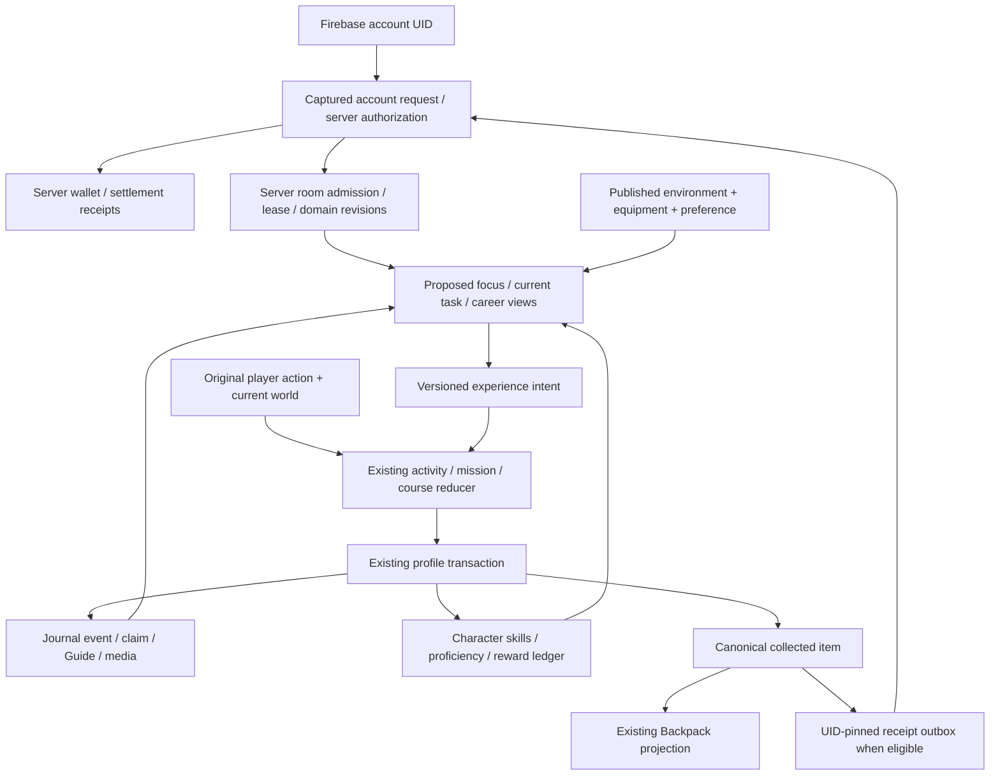

# One Explorer: authority map

Current owners remain authoritative. Proposed focus/guide views are read projections, not gameplay evidence or permissions.

| Concern | Canonical owner | Invariants / prohibited duplicate |
| --- | --- | --- |
| Account | Firebase Auth + protected API token | A career does not create an account. Capture UID before async dispatch; stale results cannot update another account. |
| Device Explorer | `discovery/profile-store.js`, character model | Preserve `local-explorer`, `local-explorer:primary`, creation state, unknown fields. Do not derive identity from focus. |
| Story and skills | Explorer event projection + `character/progression.js` | Explorer story points, practice XP, course evidence and qualifications have different meanings. Same event may project several skills once. |
| Journal/claim/item | Existing IndexedDB transaction | Claim/event/profile/Guide/custody/eligible outbox commit together. Menu clicks are not evidence. Never write XP directly from UI. |
| Backpack | `player/backpack-model.js` and v3 store; discovery projection | Stable instance and source event; repeats merge rather than multiply. Research item remains nontradeable unless its original authority authorizes a conversion. |
| Economy | Server `economy-authority.js`; existing local sandbox boundary | No new focus wallet or career currency. Unknown delivery retains original command and recovery state. |
| Vehicles/condition | Garage/condition owner, original server result validation | Focus cannot grant a car, reset damage or validate a lap. Casual client evidence is not competitive server authority. |
| Property | Original local/connected housing owner | Career view cannot bypass owner/room/floor permissions or duplicate furniture save. |
| World/travel | Session coordinator, world publication, travel and mode owners | Observe identity/generation before and after await. A focus change alone neither moves player nor stops transfer. |
| Shared room | Server admission/lease + existing domain authority | Career focus is not owner/mod role. Presence heartbeat alone cannot renew an expired seat. |
| Tutorial | Existing v6 tutorial controller, current-journey projection | Lesson resume/replay is separate from course and inventory progress. Explicit help uses current UI arbitration. |
| Focus (proposed) | Optional versioned metadata in existing profile | No new store. Save with functional latest-profile updater; validate ID against current display catalog; retain unsupported future data without executing it. |

## Event and identity contract

Keep original event IDs. A display focus never rewrites `eventId`, claim ID, source world, item authority or room revision. Cross-career credit is a single commit with several existing projections. Duplicate detection exists in claims/events and bounded character ledgers; do not treat a bounded XP ledger as the only permanent inventory dedup mechanism. A repeated real activity may generate a new legitimate event under original repetition rules; replaying the same receipt may not.

Local course updates use expected domain revision, signal/current-session guards and same-transaction sample/media/custody validation. Connected commands use existing UID/revision/request-ID rules. A future cooperative research result requires a server-owned contribution envelope, per-participant eligibility and idempotent settlement before it can pay shared rewards. The preview’s separate personal observations do not implement that backend.

## Existing-player constraints

Character migration already keeps a backup; native prototype D exercises that owner with a representative legacy fixture. New focus metadata must be optional. Never force creation on returning players or replay starter grants; never silently move Journal content between accounts. Everyone using the same browser profile currently shares the local Journal. Account sign-in is not full Journal synchronization. Explicit export/import and owner-confirmed account association need their own conflict/privacy design.

## Justified refactoring boundary

Extend `current-journey` or a small pure projection beside it after approval. Keep domain rules, registry, plugin lifecycle and profile storage. Extract a projection only when multiple existing views need it; avoid another central career engine with its own update loop. Existing shared-context compatibility remains a known gradual-refactor risk, not a reason to rewrite hundreds of modules during this R&D stop.
