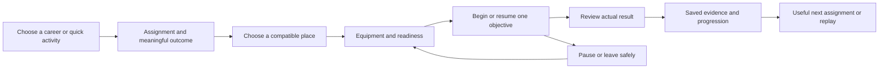

# One coherent World Explorer experience

November 2, 2026. **Implementation plan; not a completion claim.** This is the current integration sequence for activities, careers and their UI. The detailed mission requirements in [Explorer careers](EXPLORER-CAREER-PLAN.md) and [research careers](RESEARCH-CAREERS-AND-CERN.md) remain the content specifications. [Roam](../../docs/visual-redesign/OWNER_DESIGN_SELECTION.md) remains the selected art direction.

## The problem to solve

The product has useful working systems but does not consistently connect them into a player journey. The globe's Activities screen is a mode selector; the in-world Games & Activities screen is a route browser; Today contains fieldwork introductions and campaign cards; Profile presents a different set of broad paths. A player cannot use these as one understandable career flow.

The live November 2 inspection covered the public landing page, globe, mode selection, one Baltimore arrival, Today, Profile and the route browser at desktop, portrait and short landscape sizes. Source tracing covered their entry, eligibility, progression, completion and lifetime owners. A literal-import inventory screened 1,219 application modules, 226,880 lines and 3,068 resolved import edges. This is a broad inventory and focused integration audit, not line-by-line certification of the entire codebase. Authenticated rooms, complete campaigns and physical devices were not newly accepted by this audit.

The copy follow-up also confirmed an internal milestone code and engineering terminology in live Quick Start. Local source corrections separate contributor evidence from runtime descriptions; these corrections are not yet deployed. Player copy is an explicit release boundary below.

Three distinctions are essential:

- **Existing gameplay needs composition.** The three accepted racing venues, vehicle ownership/condition, Journal, campaign chapters and world/travel systems should be connected through consistent screens.
- **Some content is still missing.** Six research starter choices are introductory field assignments. They are not the complete specialist campaigns. Archaeology has catalog/tool entries; the specified archaeology campaign is absent. Mining and the traversable CERN campaign are explicitly unfinished in the delivery ledger.
- **Reliable foundations already exist.** Preserve the gameplay plugin registry, ScreenLayout/modal handling, world/session lifecycle, Journal transactions, character progression, item custody and authenticated competition authorities.

## Product structure

Keep four understandable destinations across the globe and the world: **Explore, Activities, Journal, Community**. Account/Profile and Settings remain utilities. Saved places live within Explore; tools and travel stay available contextually during play; Build & Home is reachable through its career and existing contextual controls. The same destination should retain its name, selected item and return position between contexts.

Activities has three internal views:

1. **Continue:** the selected assignment, its saved stage and one next action. Show a meaningful empty state for a new player.
2. **Careers:** searchable career cards, grouped by subject. Start with Racer, Geologist and Archaeologist, with the full existing research/creative portfolio accessible. Explain current availability and show compatible places.
3. **Quick play:** the existing independent games and routes, with filters that describe the task. Walking, driving and GPS are methods or conditions, not substitutes for careers.

The globe remains a useful geographic selector. It gains an experience summary beside the chosen place: what the player will do, readiness, required equipment, approximate activity duration, persistence and the next action. Coordinates and specialist data layers move into details. On a phone, the selected place and primary action must be visible without scrolling past a large decorative globe.

Every offered journey follows:

A selected card must lead to an explicit next step. It must not silently change a global mode and leave the player to discover that closing the panel and pressing Explore is necessary. Free exploration remains available without completing a career or signing in.

## Architecture and ownership

Build a **composed experience index**, not another gameplay authority. It references existing domain definitions and derives presentation from their current facts. All entry surfaces consume that same read model.

| Boundary | Change | Authority that remains in charge |
| --- | --- | --- |
| Experience index | Add stable experience, career and assignment IDs, display grouping, adapter ID and definition version. Compose racing, fieldwork, routes and campaigns instead of copying their facts. | Domain catalogs own vehicle specifications, route geometry, tool entitlements and qualification. `product/capabilities.js` stays descriptive, never a permission grant. |
| Offers and readiness | Produce `ready`, `needs-place`, `needs-equipment`, `needs-account`, `temporarily-unavailable` or `planned`, with a reason and a real remedy. Curated starting-place descriptors are revalidated after world load. | SurfaceQuery, world qualification, equipment and backend admission decide whether play can actually start. A catalog entry is insufficient. |
| Entry intent | Carry selected experience/assignment, destination identity and optional resume receipt through the existing title/world launch boundary. Validate before and after asynchronous preparation. | Existing world/environment commands, publication identity and actor owners. Portal URLs retain their opaque revision-checked contract; do not allow arbitrary career parameters to bypass Portal admission. |
| UI navigation | Add a small transient screen model for section, detail, selection, origin, scroll and focus return. Render title and world presentations from shared view models/components. | ScreenLayout, the existing focus trap, pause/input ownership and environment cancellation. Do not transplant the same live form between unrelated DOM parents. |
| Career progress | Store versioned assignment state, accepted place, evidence IDs, outcome and completion receipt additively in the existing profile owner. Migrate only from demonstrable prior evidence. | Journal/profile transactions own local evidence and badges. Character progression owns specialty/proficiency XP. Backend receipts own competitive rewards and connected records. |
| Runtime adapters | Small adapters invoke the existing fieldwork, racing, route, marine, planetary and creative controllers. Each exposes start/resume/stop and a read-only current objective. | `gameplay/plugin-registry.js`, domain controllers, model leases and world/session lifetime. No second frame loop, physics controller or reward store. |

Suggested seams are `experiences/definitions`, `offers`, `view-model` and domain adapters; `ui/experience-browser`, `assignment-brief`, `readiness`, `journey-result` and a transient navigation model. Agree the small contracts before moving code. Keep stable action IDs during migration, then remove replaced legacy entry arrays and styling rather than maintaining two independent catalogs.

Split `discovery/runtime.js` by responsibility while retaining its orchestration role: Today presentation, Profile presentation, evidence/Journal presentation and command adapters. It currently spans 2,612 lines and 46 imports. Size alone is not a defect; the important constraint is that presentation changes must not change progression transactions or scene lifetime. `title-screen.js` and `globe-hub.js` similarly need an explicit presentation/launch seam.

The import screen found three cyclic groups: expedition runtime/ship interior/space UI; capture UI/survey UI; and three transport compiler modules. These are maintainability findings, not demonstrated runtime failures. Extract UI-facing callbacks/contracts as those domains are changed. Keep the accepted transport compiler and driving mathematics outside this UI refactor.

## What a complete career means

A full career needs an introduction, an ordered sequence with distinct decisions, actual supported interactions, an evidence-backed conclusion, useful rewards, replay/continuation, and reliable pause/resume. A skill meter, a renamed collection timer, five empty cards or one starter task does not satisfy this contract.

The following matrix retains the existing portfolio. “Existing” below describes reusable source and previously recorded evidence, not a new full-career acceptance.

| Career/path | Existing foundation | Required finished experience |
| --- | --- | --- |
| Racer | Three accepted venues, garage/upgrades/condition, practice, trusted races, Journal, rivals/crews/classes | A solo-accessible career ladder: preparation, clean finish, improvement and a multi-event conclusion. Show car/build class, condition/repair, qualification and saved results. Rivals/crew competition is optional; do not require an occupied room. Keep the three-venue scope. |
| Geologist | Mapped geology study and field tools; one research introduction | Two real supported study exposures, observation before collection, contrasting labeled virtual samples, bench comparison, evidence-based landscape interpretation and a useful next survey. A geological map must not imply an exposed collectible specimen. |
| Archaeologist | Fictional-history catalog and excavation-tool vocabulary | Authored training site: brief, survey grid, two spatial relationships, controlled stratigraphy, contextual artifact catalog, supported interpretation and conservation/display outcome. Real heritage visits remain observation-only. |
| Mineral explorer / mining engineer | Geology/tools; authored design | Bounded virtual quarry, sampling and assay choices, extraction/support constraints, carrier custody, mass-conserving processing and restoration. No arbitrary-world extraction or client-created shared stock. |
| Palaeontologist | Fossil documentation introduction | Formation context, orientation record, bounded preparation/stabilization, morphology comparison and a past-environment report/display. Distinguish casts and training representations. |
| Oceanographer | Coastal vessel/sonar/dive/lab chapter spine | A two-station protocol, labeled source/time/method, transect comparison, same-vessel recovery, saved report and a repeatable survey. |
| Marine biologist | Marine observations and habitat systems | Surface effort/no-sighting outcomes, contrasting habitats, observable behavior sequence, confidence/context comparison and a follow-up station. |
| Wildlife ecologist | Wildlife introduction and regional ecology | Comparable stationary/transect observations in two habitats, recorded effort, confidence and paired checklist; meaningful repeat variants. |
| Botanist / restoration ecologist | Plant study and habitat introduction | Diagnostic structures, three-plant comparison, persistent study plot, explicitly simulated seasonal revisit, bounded restoration and before/after evidence. |
| Hydrologist | Water/world data and research specification | Supported upstream/downstream stations, consistent measurement protocol, catchment context, changed-condition revisit and an evidence-limited report. |
| Meteorologist | Time-stamped weather/live-data systems | Source-age check, working virtual sensor, two-station comparison, recorded forecast and later verification or an explicitly simulated replay. Opening a data panel is not completion. |
| Cartographer / surveyor | Navigation, routes and surveying proficiency | Control points, distance/bearing measurements, slope/crossing/access inspection, mapped-versus-loaded comparison and a reusable route sheet. |
| Planetary scientist | Lunar fieldwork and H10–H12 spine | Two-site preparation, observation/sample choices, reserve management, same-pod return, evidence comparison and Earth/home display. |
| Astronomer | Sky catalogs and observing specification | Working observing station, instrument settings, repeated/control observations, cited catalog comparison and a reproducible observing log. |
| Accelerator scientist | Existing Collision Lab workbenches and analysis | Admitted traversable training stations, beam/RF/focus/detector methods, recorded-event comparison and a reproducible notebook using existing analysis modules. |
| Field engineer / Maker | Useful workspace, building/home owners | Diagnosis, supported construction or repair, tested usefulness, saved design and repeatable assignment. Placement count alone is insufficient. |
| Expedition pilot | Harbor Run and transport owners | Planned route, physical cargo custody, stop/unload, handling distinction, durable delivery and a new transport assignment. |
| Documentary explorer | Three Views and photo/album owners | A visual question, genuinely contrasting images, reviewed/edited story, saved album/display and a distinct follow-up brief. |
| General Explorer | First Bearings and H01–H12 chapters | One understandable optional opening and a complete campaign-wide journey; keep the exact result → Journal review → badge link. |
| Companion handling path | Companion care/progression and custody | Make the existing care/training benefits, supported actions, costs, saved outcomes and next meaningful task understandable. Do not advertise a separate completed campaign from its specialty meter. |

Every full career must have its specified capstone plus at least two meaningful repeatable variations before receiving a “complete career” claim. These variations are a content target to implement, not a statement that they exist. All twenty rows receive an explicit status and owner; the first three named careers are the first delivery priorities, not the entire scope.

See the executing [delivery checklist](COHERENCE-DELIVERY-CHECKLIST.md) for stage states and fixed stopping points.

## Delivery sequence and stop conditions

Each gate ends with a reviewable implementation, an evidence receipt and an updated status. Reuse accepted evidence when its boundary is unchanged. Do not repeat full accepted venue laps to validate a card layout.

| Gate | Deliverable | Completion evidence |
| --- | --- | --- |
| G0 — contracts and inventory | Freeze the experience taxonomy, full portfolio/status list, owner map and old-ID compatibility. Schedule the three open moderate dependency alerts as a separately verified backend patch. | No orphaned existing entry points; explicit old → new mappings; no lost history, tools, cars or entitlements. No framework/renderer replacement. |
| G1 — one entry experience | Implement the composed index, readiness model and Activities Continue/Careers/Quick play views; replace the globe's mode list and connect existing in-world browsers to the same model. | Select a career and compatible place; see one next action; go back without losing selection; unavailable choices explain a remedy. Desktop/portrait/landscape and keyboard paths pass. |
| G2 — Racer complete journey | Deliver the first complete vertical slice using existing racing authorities and three venues. Finish its solo ladder/result/next-step flow and optional online branch. | Actual ordinary driving → correct saved class/result/condition → next event → reload/resume. Existing pit/physics/venue evidence is reused; test only changed integration boundaries. |
| G3 — Geologist complete content | Implement the specified five-stage investigation with its actual supported locations, tools, bench and conclusion. | Ordinary gameplay produces distinct source-linked evidence, classification/uncertain outcome, one receipt and a useful follow-up. Save failure, interrupted sampling and resume preserve custody. |
| G4 — Archaeologist complete content | Implement the authored training site, grid, stratigraphy, contextual records and capstone. | Physical layer/tool constraints work; context is recorded before removal; interrupted work resumes; final report/display derives from actual evidence. |
| G5 — remaining portfolio | Deliver the remaining matrix rows in bounded groups: nature/fossils; water/marine; sky/planetary; mining/engineering; pilot/documentary/CERN. Reuse existing accepted chapter spines. | Each row passes the same full-career contract. No unfinished row receives a Ready or Complete label. One authoritative board lists every outstanding requirement. |
| G6 — whole UI migration | Finish Roam tokens/components, stable navigation, contextual HUD, Journal/Profile hierarchy, short-screen layouts, empty/loading/error/saved states and public-site handoff. | No legacy neon/inline-color workaround in migrated views; same back/close/focus behavior; primary actions remain visible; no duplicate panels/listeners. |
| G7 — integrated release | Traverse the complete new-player and returning-player flows, data compatibility and relevant platform transitions; build and roll out one exact candidate. | Real interaction/result/receipt, reload and recovery for every offered full career; existing saves and rollback preserved; required CI, changed browser/backend journeys and hosted identity checks pass. Hardware claims require actual hardware evidence. |

G1 should demonstrate Racer, Geologist and Archaeologist browsing and honest availability. It must not expose working-looking Start buttons for G3/G4 content that has not been implemented. Complete and review G2 before expanding the content surface. The sequence is substantial product/content work; calendar estimates should be based on the first completed slice, not invented from the number of menu cards.

## Concrete UI and quality requirements

- **Player-facing copy:** menus, mobile layouts, tooltips, notifications, errors and game previews contain game language only. Keep AI/assistant wording, planning notes, milestone codes, source-review claims and acceptance/implementation commentary in contributor documents outside the shipped app. Explain availability, controls and saves in plain player language. Keep design-review caveats outside simulated game UI; do not disguise unfinished content as playable.

- **Briefing:** purpose, actual task, supported location, method/equipment, activity duration separate from world loading, reward, persistence and one primary action.
- **Readiness:** offer an eligible place, equipment/garage action, sign-in or retry. Never silently remove a chosen career because the current place lacks a matching lead.
- **During play:** one pinned objective, a valid target/distance where available, pause/continue later and safe cancellation. Show walking information in walking mode; vehicle gauges are contextual.
- **Results:** actual outcome, evidence, saved/pending/failed state, useful progression and next/replay choice. Do not show a durable reward before commit. Local Journal, connected car/result and account profile state remain distinct.
- **Mobile:** verify 390×844 and 844×390 plus desktop 1440×960, 200% text, safe areas and virtual keyboard. Use a list/detail switch on short screens. The globe cannot push the launch summary off the first screen. Aim for 44px primary touch targets; WCAG 2.2 AA minimum target sizing and exceptions are assessed separately.
- **Accessibility:** shared modal/focus handling, Escape/back, restored focus/scroll, visible keyboard focus, clear labels, reduced motion and tested contrast. Existing focus handling is retained; every migrated panel must join its contract.
- **Distance labels:** distinguish “to start” from “route length.” The observed Harbor card's 478m is distance from the player, while its description says a roughly 150m walk. This is a labeling problem, not proof of incorrect route geometry.
- **Recovery:** loading has a safe return/cancel path using the world owner; provider errors show coverage, freshness, a suitable alternative and retry policy. Never turn headless App Check rejection into a universal production failure claim.
- **Visual quality:** maintain Roam's forest/charcoal, cream and amber system. Use shared typography, spacing, active states and content cards. Retire style selectors that match old inline color strings. Keep real mapped places and accepted assets.

## Evidence and acceptance discipline

Keep four separate evidence levels: source review, component/storage tests, actual browser journey and actual hosted/backend/hardware evidence. The November audit is live UI evidence plus source inspection; it did not complete the careers.

For each delivered slice, exercise choose → prepare → real action → result → exact saved evidence → useful next action → reload/resume. Include unavailable place, missing equipment, account change, world replacement, two tabs, offline/failed save, double completion and leaving a room where affected. Preserve original receipt IDs, duplicate-grant fences and competitive class identity.

Run focused checks after each change and the required repository checks at integration. Reuse unchanged accepted vehicle, pit, Ocean, Space and platform evidence. Run one heavyweight local process at a time. Never certify a full career from source assertions, synthetic completion or an attractive card. Observe several first-time players attempting the three priority journeys without coaching; record where they get stuck and time-to-choice separately from load time. This user observation is still outstanding.

## Research informing the design

These are transferable patterns, not a claim that the reference products have no flaws or that World Explorer should copy their visual assets.

| Primary reference | Relevant pattern | Application here |
| --- | --- | --- |
| [Forza Horizon Adventure](https://forza.net/news/forza-horizon-5-road-to-mexico-september-update) and [pinned accolades](https://support.forza.net/hc/en-us/articles/16905350880787-FH5-Unlock-Online-Features-and-Message-Center) | Small achievements connect to a chosen branch; a selected goal can guide free play. | Racer progression and one pinned next assignment, without gating ordinary exploration. |
| [Microsoft Flight Simulator first steps](https://www.flightsimulator.com/guide/what-should-i-do-first-in-microsoft-flight-simulator/) | Training, qualifications and specialized missions have an explicit relationship. | Show methods, prerequisites and actual unlocked work, with a remedy for missing readiness. |
| [No Man's Sky Waypoint](https://www.nomanssky.com/waypoint-update/) | Centralized catalog/guide and pinnable milestones connect knowledge to the mission log. | Separate career planning, active assignment and collected knowledge while linking them. |
| [iNaturalist observations](https://help.inaturalist.org/en/support/solutions/articles/151000192921-how-to-make-an-observation) | Evidence, identification and submission/review are distinguishable steps. | Research evidence must lead to an inspectable record and interpretation, not an unexplained XP increment. |
| [NN/g usability heuristics](https://www.nngroup.com/articles/ten-usability-heuristics/) and [progressive disclosure](https://www.nngroup.com/articles/progressive-disclosure/) | Status, recognition, consistency and deferring secondary detail. | One next action; reveal coordinates, locked branches and advanced settings on request. |
| [Apple navigation design](https://developer.apple.com/videos/play/wwdc2022/10001/) | Stable top-level destinations and clear detail/back hierarchy. | Keep the player's section and return context across globe/world/mobile presentations. |
| [WCAG 2.2](https://www.w3.org/TR/WCAG22/) and [target-size guidance](https://www.w3.org/WAI/WCAG22/Understanding/target-size-minimum) | Focus visibility, operable controls, readable/reflowing content and target sizing. | Explicit acceptance checks, not an unmeasured compliance claim. |
