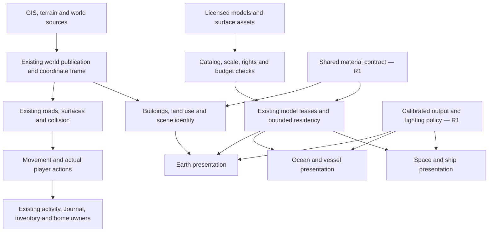

# A realistic World Explorer: one visual system across the world

October 10, 2026. Working source follows `d41ff0df`; released 5.5 is unchanged.
This is an implementation design grounded in source inspection, not a claim that
photorealism or all later campaign chapters are already delivered. Runtime
measurements and images belong in the delivery ledger, separately from this plan.

## Decision

Build a consistent physically based world on the existing geographic, surface,
streaming and interaction authorities. Start with a representative street and
its streamed continuation, then carry the same material, lighting, scale and
asset rules into the vessel, underwater environments and spacecraft. Keep broad
world coverage and the curated-location/continuous-world switch.

Do not switch engines or increase every texture to 4K as the first intervention.
A renderer can reproduce convincing light, but it cannot recover missing facade
geometry, meaningful street placement, good animation or real surface information.
Detailed nearby assets and economical distant representations must describe the
same place. The target is convincing interactive play, including night, rain,
turning the camera and leaving the starting area—not a single flattering still.

## What the code actually does

| Finding | Current source evidence | Consequence / required change |
| --- | --- | --- |
| The primary engine is vendored Three.js r128 | `app/vendor/three/build/three.min.js`; `engine/scene-bootstrap.js` | Establish renderer compatibility tests before changing versions. Modern examples cannot be pasted into this engine unchanged. |
| Earth already has physically correct lighting, ACES exposure, sRGB output and a procedural PMREM environment | `engine/scene-bootstrap.js`, `engine/quality.js` | Preserve the recent output/readability repair. Tune assets against this calibrated pipeline before changing exposure again. |
| High quality principally enables larger shadows, bloom, SMAA and optional SSAO | `engine/quality.js` | It is not a high-detail world preset. Detail residency and material quality need explicit budgets and policy. |
| Near/mid building surfaces use color textures, uniform roughness/metalness and shader-drawn openings | `engine/building-facade-materials.js`, `world/building-facade-layout.js` | Flat windows, repeated entrances and uniform response remain apparent even with more resolution. Need matched material channels and genuine nearby architectural depth. |
| Far buildings use another neutral atlas and procedural floor/window pattern | `terrain/far-building-facade-material.js` | The world changes visual language with distance. Near/mid/far must share one exterior identity and use intentional simplification. |
| Road appearance and physical height already have separate owners | `terrain/material-cache.js`, `world/surface-contract.js`, transport detail modules | Visual roughness must not modify the driving surface. Use micro-normal detail, not displaced pavement or a second sidewalk generator. |
| Model templates already have shared leases and a 64 MiB idle cache limit | `assets/model-template-cache.js` | Reuse that lifecycle. The idle limit is not a bound on active scene memory or every texture cache. |
| Earth, ocean and space have distinct active presentation owners | `runtime/renderer-owners.js`, `ocean.js`, `space/scene.js` | Keep environment lifecycles but standardize output/material policy. The audit found space missing sRGB output and AR using an ineffective modern-only property. The shared `engine/display-color-policy.js` now handles all renderer constructors; exposure and tone mapping remain scene-owned. Calibration evidence is recorded below. |
| Custom shader dependence is material | Pre-change static inventory of `app/js`: 954 JS files, 13 files using `onBeforeCompile`, 7 using ShaderMaterial, 23 colorSpace and 30 encoding assignments | These are search counts, not defects or GPU measurements. Each shader/texture owner needs classification. Modern and legacy color APIs must not be mixed blindly. |
| Texture assets are mostly ordinary images | 109 files under `app/assets/textures`, including 85 JPG, 8 PNG and 10 WebP, plus metadata | Compressed downloads alone do not imply low GPU memory. Build GPU texture compression and residency deliberately. Embedded GLB textures are additional. |
| Research vessel/deck and some fleet/ship replacements are not finished | Actual current source and `CURRENT-STATE.md` | Loading a better hull does not finish deck collision, doors, ladder, camera, boarding or sub deployment. These remain playable-asset acceptance work. |

These findings explain several quality ceilings. They do not prove that every
surface is incorrectly encoded, or that every scene has the same bottleneck.
Profile the actual active scene before assigning a performance cause.

## Measured starting point: loaded Baltimore source world

A controlled Chromium observation at 1440×900, medium quality and pixel ratio 1
recorded 49,023 mapped buildings and 18,952 roads. The sampled render reported
769 calls, 3,878,561 triangles, 73 programs, 937 GPU-tracked geometries and 181
GPU-tracked textures. This includes the current renderer's reported frame work,
not a count of individual buildings drawn.

The scene traversal found 2,612 material objects: 1,191 Standard, 1,359 Lambert,
61 Basic and one ShaderMaterial. Direct material properties referenced 681 color
maps, 65 normal maps and 65 roughness maps; texture instances are shared across
some materials. It found 169 unique direct-property textures, none compressed,
with an approximate RGBA8/mipmap cost of **269.3 MiB**. That excludes shader-uniform
textures, environment and compositor targets, cached-only assets, browser overhead
and decode memory. It is not measured VRAM. Hidden/unculled objects were included;
scene visibility flags do not measure what the camera actually draws.

This early post-load snapshot had recent long frames and unpopulated percentile
fields. It does **not** establish steady-state frame pacing, a leak, or spare
memory for a global resolution increase. Keep world coverage while reducing
redundant materials and introducing compressed/shared surface detail. The quality
ceiling is content consistency and resource policy as well as shading features.
The private receipt is `output/harbor-realism-20261009/acceptance/visual-audit.json`;
the associated delivery run later failed its interaction wait, so this receipt
is a visual baseline, not an overall gameplay acceptance pass.

## First implemented correction: one display-color owner

`engine/display-color-policy.js` now configures the supported output API for every
renderer constructor, either directly or through the auxiliary factory. It does
not alter texture roles, tone mapping, exposure, light intensities or render-target
formats. The existing r128 composer keeps its one final display conversion.
This removes the missing space conversion and the ineffective modern AR setting.

The actual pixel calibration compares 28 direct/auxiliary samples across space,
Earth, Ocean and interior tone/exposure configurations; all are within two byte
values. Un-tonemapped samples also match the sRGB transfer function. The existing
24 direct/composer comparisons pass with maximum difference four byte values.
Paired actual space-scene images and the day/night/storm player-asset fixture
were inspected. These are bounded renderer and scene checks, not proof that all
materials, live environments or AR devices are visually calibrated.

R0 still needs the complete representative scene/weather reference set. R1 still
needs the material records, matched map projections, residency accounting and
art acceptance below. The first correction is complete; those larger gates are
not labeled complete by association.

## Five finite delivery gates

### R0 — Establish an honest baseline and common visual contract

1. Capture the same saved camera/movement paths in dry midday, overcast, wet
   dusk and readable night. Include a starting street, a streamed district,
   hillside/tunnel entrance, bridge, park, research deck, dive and ship interior.
2. Record active renderer owner, output transform, exposure, drawing-buffer
   size, render calls/triangles/programs, material classes, texture dimensions,
   estimated residency, active templates and frame-time distribution. Distinguish
   allocated resources from visible geometry and estimates from actual VRAM.
3. Inventory each active material owner with color-space policy, texture scale,
   normal convention, weather response, shadow behavior and disposal owner.
4. Add neutral calibration geometry, a reference chart and representative
   licensed materials to the existing test fixture. Compare direct render and
   composer output, then Earth/ocean/space. The fixture is verification content,
   not new scenery exposed to players.
5. Freeze references before subsequent work. Every change carries paired images
   at the same view/time/quality, plus a movement clip. Keep failed receipts.

Exit: a reproducible baseline and explicit regression limits. No claim of a
higher frame rate or extra GPU headroom based on how smooth one flight felt.

### R1 — Shared material and lighting foundation

Define material records that all scenery owners consume. Each record needs:

- Stable material ID/version; source URL, creator, license and attribution.
- Physical tile size in metres, UV/projection policy and intended surfaces.
- Base color and emission in sRGB; normal, roughness, metalness and AO as data.
- Normal orientation, channel packing, alpha/cutout rules and mipmap policy.
- Near/mid/far representations; texture edge/decoded-byte limits per tier.
- Dry/wet response with bounded parameters, no automatic mirror-like asphalt.
- Fallback material, load status, cancellation and ref-count/disposal owner.

Keep meter scale and material identity stable across origins, rotations and
streamed tile changes. Adding roughness/normal maps requires matching their
projection to the custom facade shader; assigning `normalMap` with unrelated UVs
would be incorrect. Brick size and floor height must not change at LOD boundaries.

Use existing material pools and model leases, extending them with shared resident
texture accounting instead of adding a parallel global loader. Texture upload
jobs must fit the streaming scheduler, with cancellation on obsolete requests.
No synchronous image decoding or shader linking in the driving frame.

Standardize one output contract across environments while preserving their
physical conditions and readability. Outdoors use the existing sun/sky authority;
interiors use authored lighting and bounded local reflection probes. Avoid a
single outdoor HDR sky illuminating enclosed rooms through their walls. Changes
to night are evaluated with the character, controls and destination readable.

Exit: calibrated brick, stone, concrete, asphalt, glazing, painted metal and
wood across all quality tiers; correct lighting in at least Earth and one
interior; no double encoding, broken normal projection or growing resource count.

### R2 — A complete street, plus its streamed neighbor

Use Baltimore Light Street/Inner Harbor as the first acceptance route, including
ordinary blocks outside the original detailed location. This is a test route
for reusable systems, not a permanent special-case street renderer.

- **Buildings:** source-grounded footprint, height, roof and use; coherent floor
  spacing; recessed glazing/doors, ledges and roof edges only in the close tier;
  shared trim/detail sets rather than a unique material per building. Interiors
  behind windows must have plausible depth and scale, with a cheap middle tier.
- **Street edge:** one accepted pavement/curb owner, clear crossings, coherent
  corners and driveway breaks. Fixtures placed through the existing roadside
  resolver so poles, cases and benches cannot occupy carriageways or intersections.
- **Storefronts:** correct scale and readable restrained signs, doors/windows that
  align to facade bays, localized variation. Do not fabricate a real shop's exact
  identity when the data only supplies a generic commercial building.
- **Roads/structures:** material detail, markings, expansion joints, parapets and
  portal finishing follow the existing physical road/bridge/tunnel geometry.
  No visual displacement that creates jagged ramps or changes vehicle contact.
- **Land use:** parks have paths, vegetation hierarchy and usable space; woodland
  has canopy/understory and clear trails; industrial ground differs from lawns.
  Preserve data provenance. Procedural dressing is plausible, not surveyed truth.
- **People:** consistent licensed character scale/style, foot contact, walk/run
  transitions, stops and obstacle avoidance. Crowd variety must not add a full
  material/animation stack per person. Distance animation tiers remain explicit.
- **Objects:** one coordinated prop palette and wear level. Avoid combining
  unrelated low-poly props, photogrammetric rubble and pristine generic buildings.

Exit: daytime and night walking/driving through both districts; no sidewalk webs,
missing outer buildings, changes in mapped coverage, terrain penetration, obvious
facade swaps or newly visible stalls. The road/bridge/tunnel regression remains
mandatory even if only presentation code changed.

### R3 — Carry the contract through ocean, vessel and spacecraft

Research vessel: finish licensed hull/deck asset intake and optimization, then
verify physical decks, doors, ladders, helm, railings, collision and cameras.
All boarding, overboard swimming, dive, sub deployment and return actions need
visible, reachable affordances. Match scale, material response and lighting to
Earth. A case, work surface or screen should look like functional equipment.

Water: align rendered wave scale/speed with boat buoyancy and swimmer contact;
coordinate wind/waves/current labels with the environmental data authority.
Add shoreline transitions and depth response before more screen effects. Use
bounded reflection/refraction tiers; glass-like still water everywhere is wrong.
Underwater needs depth-dependent absorption, suspended detail, lighting falloff,
seabed scale and habitat-specific animals/vegetation, including LOD and animation
budgets. Nothing should claim a live animal is present at an exact real location.

Space/ship: preserve stylized destination composition where scientifically
uncertain, but unify scale/material/lighting quality. Finish inconsistent props,
portal/door/light transitions and observation screens. Moon/planet surfaces need
coherent meter scale at character, vehicle and aerial distances, not a single
large repeated image. Test Earth return and resource teardown during transitions.

Exit: complete Earth→vessel→swim/dive/sub→Earth and Earth→ship→surface→Earth
journeys with consistent presentation and stable ownership. Full campaign and
media capture depend on these actual journeys, not asset-viewer screenshots.

### R4 — Expand and qualify the browser tiers

Use one coherent content system with measured quality tiers. Provisional targets
below are budgets to test, not measured capabilities or promises:

| Tier | Resident art target* | Near-detail radius | Rendering target |
| --- | --- | --- | --- |
| Mobile / conservative | 192 MiB | 35–60 m | Stable pacing, 30 fps goal, simpler reflections/shadows |
| Balanced desktop | 384 MiB | 80–120 m | 1080p, 45–60 fps goal, shared PBR and normal detail |
| High desktop | 640 MiB | 150–220 m | 1080p, 60 fps goal where measured, richer near geometry/probes |

*Managed meshes/textures including active and idle art; excludes renderer targets,
JS heap, map buffers and browser overhead. GPU allocation is not reliably available
from a browser; conservative estimates and observed pressure both matter. These
numbers must be reduced if the 8 GiB host or Android exhibits pressure. They are
not permission to allocate the entire target at launch.

Prioritize visible screen area, distance and travel velocity; load ahead during
flight and evict behind. Retain logical map identities when presentation detail
is evicted. Coalesce jobs, bound uploads/decodes and prevent obsolete async loads
from repopulating abandoned worlds. Quality changes must release replaced assets.

Every promotion runs a fixed movement route, ten world/interior transitions, a
continuous-world outward/return route, save/restore, tab background/resume and
context-loss recovery. Compare warm-state memory/resource counts for a plateau;
a single rising sample is not a leak diagnosis, and a single successful unload
is not a soak pass. Use frame-time percentiles and long frames, not average FPS
alone. Physical Android acceptance remains distinct from a phone-width desktop.

Exit: cross-environment parity and stable repeated-session budgets, then update
landing/GitHub/media using the accepted build. Keep a rollback package. No new
paid data service is part of this plan.

## How this joins the existing game

Art upgrades do not redefine road height, geographic coordinates, cargo custody,
mission progress or ownership. A campaign can require a finished physical asset,
but a higher graphics tier must not be required to complete it. Photography must
capture the actual active presentation owner. Home photo displays and saved Maker
arrangements need bounded texture/object residency and explicit export/deletion;
they do not create a second uncapped asset cache. This keeps the campaign and
visual roadmap compatible without bundling unfinished chapter buttons into the UI.

## Renderer modernization: a separate bounded experiment

The current Three.js WebGPU renderer has a WebGL2 fallback, but its official guide
requires replacing custom GLSL/onBeforeCompile and EffectComposer code with the
node/TSL pipeline. Its guide still describes migration limitations. Therefore:

1. Inventory the 13 shader-patch and seven ShaderMaterial source owners, including
   facades, water, atmosphere, planet and output conversion. Classify semantics,
   tests and dependencies; search counts may overlap.
2. Prove a small equivalent scene under the existing renderer and a pinned modern
   Three.js revision. Include skinning, instances, transparent water, context
   lifecycle and the actual geospatial transforms. No production engine switch.
3. Port/test shader families one at a time with the same material descriptors.
   Preserve a tested current-renderer path until complete world parity passes.
4. Measure WebGPU and its WebGL2 fallback on target devices. Adopt only if visual
   and frame-time evidence justify migration cost. WebGPU availability alone is
   not evidence of an improvement.

Photogrammetry/3D Tiles can provide licensed high-detail districts where available.
Use them as an optional scenery source reconciled to existing geographic identity
and collision. Do not stack them over duplicate OSM buildings. Captured baked
lighting, weak close-up meshes, absent interiors and source rights need evaluation.
Gaussian splats may suit selected non-interactive vistas; they do not supply road
contact, navigable interiors or reliable relighting by themselves. No paid global
provider or claim of worldwide surveyed photorealism is assumed.

## Research checked October 9

- [Three.js color management](https://threejs.org/manual/pages/color-management.html):
  linear lighting, different color/data maps and one display conversion. This is
  modern documentation; r128 needs its version-appropriate API.
- [Three.js textures](https://threejs.org/manual/pages/textures.html) and
  [KTX2Loader](https://threejs.org/docs/pages/KTX2Loader.html): decoded texture cost,
  filtering/mipmaps and device-compatible GPU compression. Download size is not
  the memory budget.
- [Three.js WebGPURenderer migration](https://threejs.org/manual/pages/webgpurenderer.html):
  backend fallback and incompatible legacy custom shaders/postprocessing.
- [Cesium 3D Tiles](https://cesium.com/why-cesium/3d-tiles/): an open geospatial
  streaming format; a format does not grant rights to a particular dataset.
- [Babylon feature demos](https://www.babylonjs.com/featureDemos/): examples of browser
  PBR/reflections and other individual rendering capabilities. They demonstrate
  possibilities, not World Explorer's performance or whole-world completeness.
- [Poly Haven license](https://polyhaven.com/license): candidate CC0 material/model
  assets. Record the actual files/version and attribution policy at intake; check
  any third-party source separately.

The architecture, rollout order and provisional budgets above are project design
judgments based on these references and the inspected code. They are not claims
that another engine or game solves this project's missing content automatically.

## Additional observed scene issue — October 10

The Three Views city journey provides a reproducible R2 case: the loaded feature
`overture:25ccfdfc-084c-4595-a6e6-c1723df352f6`, labeled Battle Monument, is
represented by a narrow generic building facade. Its landmark form is not
communicated by that geometry. Review source classification, landmark admission
and any existing specific representation before applying building materials.
This is an observed representation mismatch, not a claim that the source geometry
or the surrounding street reconstruction has been surveyed. The final city
photographs are in the ignored career-continuation evidence folder. Campaign
capture adds no road, bridge, tunnel, terrain or building geometry changes.
