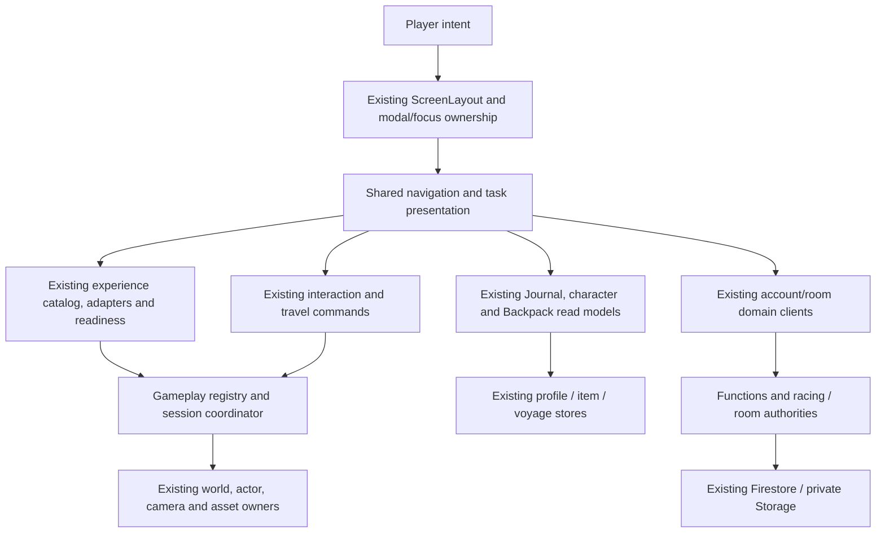

# Proposed product and interaction architecture

Proposal for the next redesign, not an implementation or a change to the deployed release. Audience decision: mixed ages and experience, simple entry and optional depth. Preserve the selected Roam identity and all existing gameplay, data and platform authorities.

## A common navigation framework

Use the same five named destinations in the start hub and every world. Their desktop, phone and spatial layouts may differ, but their meaning, selected record and return behavior must agree.

| Destination | It answers | Contents |
| --- | --- | --- |
| Explore | Where can I go, and what is here? | Earth places, map/search, Ocean sites, space atlas, saved places, Portal, live data, coverage and nearby facilities. Browsing does not travel. |
| Activities | What can I do or continue? | Continue, interest groups, all twenty careers, quick play, routes, racing and expeditions. One explicit next action and honest prerequisites. |
| Journal | What have I done, kept or learned? | Original records/photos/reports, collections, career results, skills, companions, personal trail and return links. Existing independent histories remain separate. |
| Create | What can I make or manage? | Tracks/routes, Blocks, home/workspace, exhibits, photo/layout contributions and publication status. Draft → validate → share/publish is explicit. |
| Together | Who can I play with, and what is shared? | Friends, rooms, invitations, chat, roles, shared activities, block/report and membership/privacy. Joining a room does not imply every solo feature is replicated. |

Profile/account, saves/backup, accessibility, controls, performance, help and legal information are stable utilities. The Backpack/kit, contextual Travel, camera, map, interaction and recovery remain directly reachable during play; a person should not navigate through a profile to brake, board a vessel or use a nearby door. Rankings live with activity results and have a shortcut from Together; avoid two competing ranking implementations.

This changes the prior four-section proposal only at the presentation layer: Create gains explicit discoverability, and Together replaces the ambiguous social grouping. Preserve existing public action IDs and aliases while labels are evaluated. Do not expose intentionally hidden legacy room-game/track buttons merely because source exists.

## Destination hierarchy and domain differences

| Domain | Entry and hierarchy | Default instruments / actions | Distinctions the UI must preserve |
| --- | --- | --- | --- |
| Earth | Place search or Here → resolved district → optional building/interior | Place and mode, map, context action; nearby useful work | Detailed starting district vs optional regional scenery; geographic browsing vs a recorded visit; GPS once vs follow. |
| Ocean | Earth/coastal site → research vessel or eligible dive site → deck/sub/diver | Vessel identity, chart/course; depth/air/condition when relevant; board/deploy/recover | Surface vessel, ship deck, sub and diver are different actors. Chart depth/model depth/game depth, solo voyage and shared marine roles remain distinct. |
| Moon and Mars | Space atlas → body → supported surface or orbit option | Suit/rover state, local map, survey kit, return/deploy | Existing landing policy decides what can be entered. No implied landing on every catalog planet. Surface position and career persistence have different scope. |
| Solar System | Universe → Milky Way → Solar System → body/moon/spacecraft | Selected destination, current course, scale/time, assist and cancel | Observing an object, plotting a course, assisted flight, arrival and descent are separate states. Selection never silently commits travel. |
| Stars and deep space | Hierarchical atlas/list/search → system → body or region | Breadcrumb, selected object, distance with units, provenance, travel capability | Observed, modeled and authored objects remain labeled. Disambiguate repeated planet names by parent system. Preserve the existing coordinate/scale conversion owners. |
| Solis Reach / Pathfinder | Ship or expedition → station/crew → deployment → survey → return | One current task; contextual station tools and ship/pod condition | The ship, pod, crew role, command lease and expedition record retain their current authorities. No new UI-owned ship simulator. |
| Buildings, home and rooms | Same geographic/room context → authorized entrance/workspace | Door/floor/exit, build or display tools only while active | Virtual property differs from legal ownership; local home, online property and shared room are not interchangeable save scopes. |
| Portal / installed clients | Native or web place card → qualified existing destination | Continue/saved place with a clear open-in-app action | Widget preview is not an in-world visit. Background/native lifecycle and physical VR remain separate from web UI acceptance. |

Offer a text/list alternative to every map/globe/body picker. Keep Earth, Ocean and Space as labeled shortcuts, with Moon/Mars favorites if useful; the atlas supplies the actual parent hierarchy. Don't force a novice to learn astronomical addresses before choosing an experience.

## Predictable flows

1. **First visit:** choose an understandable intention (explore a place, try a guided activity, or play with others), adjust needed access settings, then enter. Guest solo play and free exploration stay available. A career choice is optional and reversible.
2. **Returning player:** show real resumable work and where it resumes. Separate Continue assignment, Return to place and Resume voyage if their existing persistence differs. Say what is retained before changing an actor/world.
3. **Career:** interest → career brief → compatible place → readiness/equipment → begin/resume → one current objective → original result → saved proof → useful next choice. Keep the existing varied procedures; this is a shared presentation contract, not identical tasks for every career.
4. **Travel:** inspect destination → view available visit/orbit/land/board options → confirm the actual transition → truthful loading → arrival and controls. Back/cancel keeps the current world usable. Local locomotion controls never share a list with destructive world replacement without a clear boundary.
5. **Creation:** choose track/build/story/capture → create/edit a draft → inspect clean preview → validate with the current owner → choose private/local, current room or supported reviewed publication → acknowledge actual success. Keep original revisions, stable anchors, geometry and permission rules.
6. **Social:** choose a friend/room/invite → show world, permissions and supported shared actions → join → understand current role → leave/reconnect safely. Block/report is reachable from the relevant player/message. No automatic public publishing.
7. **Recovery:** name the failed operation, what is still available/saved and one valid remedy. Retry reuses the original pending intent where required. Never display “saved online” or grant completion from a button click alone.

## Career-specific tools, consistent navigation

Use reusable workspace patterns, selected deliberately through the active assignment. Keep global navigation and basic controls fixed. A career changes useful tools, report sections and guidance; it does not create a separate app or hide all other careers.

| Career | Useful foreground tools and presentation | Visible outcome / return reason |
| --- | --- | --- |
| Racer | Event/venue, real owned car, condition, lap/checkpoint, clean driving and pit/repair access | Actual race result, existing ladder/rival record, meaningful next event or track creation. |
| Geologist | Map/exposure, measurement/sample custody and comparison plate | Saved supported landscape interpretation and next comparison. |
| Archaeologist | Site/grid/context sequence, packing and catalog/conservation | Context-bound finds, interpretation and preserved site case. |
| Mining engineer | Quarry survey, extraction/mass accounting and restoration | Material report and restored-site review. |
| Palaeontologist | Fossil context, preparation and morphology comparison | Specimen/report and exhibit revisit. |
| Oceanographer | Ship chart, water-column instruments, seabed survey and lab | Paired station report and same-vessel return. |
| Marine biologist | Observation effort, habitat/depth comparison and original evidence | Habitat report and comparable follow-up. |
| Wildlife ecologist | Habitat map, watch/transect effort, camera evidence and limits | Comparable watches and another supported method. |
| Botanist | Diagnostic photos, probe, marked plot and declared season | Before/after/control report and saved planting revisit. |
| Hydrologist | Paired stations, flow/optical readings and source-time labels | Watershed plate and declared-condition comparison. |
| Meteorologist | Instruments, forecast before replay, prediction/error comparison | Forecast evaluation and another scenario. |
| Cartographer | Route measurement, reciprocal checks and access annotations | Saved usable route sheet and another supported route. |
| Planetary scientist | Body/site, calibrated field measurements, samples and return | Lunar comparison/report and supported next survey. |
| Astronomer | Target/time, alignment, repeated observation and log | Reproducible observing record and another target. |
| Accelerator scientist | Facility stations, beam/detector controls and recorded-data plots | Original experiment analysis and a contrasting case. |
| Field engineer | Need/plan, existing build tools, physical test and workspace | A useful artifact, test result and retained project. |
| Expedition pilot | Vehicle/cargo readiness, route, condition and delivery | Saved delivery and next route with existing rules. |
| Documentary explorer | Shot plan, original images, captions/order and album preview | Finished visual story and a linked place revisit. |
| Explorer | One bearing, nearby observation and chapter map | A kept discovery and a chosen next journey. |
| Companion handler | Current companion, custody, care, learned command and physical return | Existing trust/skill outcome and next useful handling task. |

No new leveling system is proposed. Character attributes/proficiencies/specialties, career completion, wallet credits, vehicle upgrades and evidence collections remain different facts. Present only the benefit relevant to the completed task, with details available in Journal. Never imply a badge is a real professional certification.

## UI-to-system contract

- Extend `ui/screen-layout.js`, current modal/focus handling and existing Roam components. Use one panel host/presentation policy, with responsive/spatial adapters. Modal vs nonmodal behavior is explicit.
- Compose `experiences/catalog.js`, `experiences/runtime.js` and existing domain adapters. The 100-row capability guide is descriptive; it never grants permission or substitutes for readiness. Add display metadata to the appropriate existing catalog rather than maintaining a second career/vehicle/body database.
- Reuse `interaction/context-router.js`, `travel-mode.js`, `controls/action-input.js` and the active actor's binding/prompt publications. Do not create another input loop, camera owner, physics controller or recovery authority.
- Keep application section/history state separate from `game/navigation-state.js`, which owns an in-world destination. A remembered UI tab is not a geographic waypoint. Keep only portable IDs/return tokens, never Three objects, DOM nodes or actor poses in UI state.
- Derive display state from existing profile, character, item, voyage, condition, account and room owners. UI preferences use the established preference boundary; they do not require a new database or save migration. No old histories are merged, rewards regranted or original photos pruned.
- Retain `session-coordinator.js` generation/abort fencing and plugin lifecycle. After an await, a view cannot start an action, reopen a panel or acknowledge a result for a retired world/account. Shared context remains compatibility access, not a reason to add new global writers.
- Treat local saves, online acknowledgements, unknown/pending transactions and published contributions distinctly. A common status component explains those states without pretending they share persistence.
- Domain UI should publish coarse changes and reuse cached DOM. Do not enumerate careers, reread IndexedDB or redraw an extra 3D preview every simulation frame. Preserve existing render/simulation/asset leases and budgets.

## Meaningful progression and return visits

The default home shows one genuine resumable task, a small set of compatible suggestions and an easy free-exploration choice. Suggestions may use explicit interests and existing progress; they must not fabricate nearby wildlife, supported roads, live events or entitlement. Explain why a suggestion fits and let the person dismiss or change it.

After a result, answer three questions: **What did I finish? What did I keep or improve? What could I do next?** Link directly to the original Journal evidence and the actual next readiness state. Keep completed projects, plots, photos, routes, exhibits, vehicles and companions useful to revisit. Optional friends/crew work offers relatedness without making solo progress dependent on a room.

Start with existing content and unlocks. Do not add currencies, attendance streaks, energy timers or more careers to solve navigation. Proposed session-length labels are estimates to validate from actual tasks, not measured promises. Assisted practice stays distinguishable from comparable ranked results under the current rules.

## Accessibility and responsive contract

- Default body text proposal:16px CSS with 1.5 line height; secondary task text at least14px; clear labels and section headings. Use existing text scaling through 200%, including errors, graphs and tooltips. Evaluate actual glyph/read distance separately on VR/large displays.
- Target44×44 CSS px for primary touch actions, with separation. This is the product target, stronger than the WCAG 2.2 minimum; verify exceptions contextually. Touch, mouse, keyboard, controller and XR equivalents invoke the same commands.
- Text/icons/patterns accompany color. Aim for WCAG 2.2AA contrast for web UI; test focus visibility/obscuring, semantics, status announcements and drag alternatives. Native platforms retain their own semantics.
- Phone: bounded full-height sheet for planning; compact bottom navigation in play; map/tools and touch movement zones cannot overlap. Short landscape may use a side sheet. Don't shrink type to squeeze desktop columns into a phone.
- Desktop: a stable navigation rail/header, one principal detail region and a contextual instrument/tool area. Expert density is opt-in; essential state never disappears.
- VR: an ergonomic spatial menu/instrument presentation of the same actions, with seated reach, recenter/exit and alternatives to mandatory bodily movement. Flat CSS target sizes do not establish XR comfort or accessibility.
- Guidance, reduced motion/flashes, contrast, input alternatives and sound/subtitle choices remain independently configurable. No career or age assumption overrides a player's accessibility choices. Essential save, condition, permission and safety feedback stays visible even when guidance is reduced.

## Cross-system handoffs to preserve

| Player flow | Existing boundary that decides the result | What the redesigned UI must explain |
| --- | --- | --- |
| Place → career → world entry | Experience adapter readiness, committed world publication and session generation | Inspecting a place has not traveled; rejected/cancelled entry keeps the prior usable context. |
| Actor → tool → nearby action | Active travel actor, action-input bindings and interaction resolver | The current role determines usable tools and prompts; a panel cannot continue steering behind focus. |
| Photo/measurement → report → Journal → backup | Existing instrument/photo evidence, profile transaction and media/backup validation | Keep original pixels, context, sample custody and failed-save retry; a thumbnail is not new evidence. |
| Race → condition/garage → career → leaderboard | Vehicle handback, original local/server result and existing ranked class/reward rules | Distinguish practice, accepted results, pending upload and real repair/upgrade confirmation. |
| Ship → submarine → diver → return | Parent-vessel/voyage identity, deployment/recovery and shared lease owners | Boarding, recovery and reload have different return behavior; personal and room voyages stay separate. |
| Course → body → expedition → sample → ship lab | Universe/course/landing policies and existing expedition commands/progress | Viewing, arriving, landing, partial recovery and publishing an analysis are separate stages. |
| Service → credits → Backpack delivery | Existing account-bound commerce intent, server receipt and item delivery marker | Unknown acknowledgement stays pending; retry the original intent rather than charge or grant again. |
| Draft → room share → reviewed publication | Existing revision, membership, privacy and moderation authorities | Each audience/success state is explicit. A saved draft is not a published building or public race. |
| Account/world change → returning UI | Existing identity listener, generation fencing and local store ownership | Retire stale callbacks without deleting local histories or confirming another account's command. |
| Widget/Portal → qualified app entry | Existing destination qualification, native/browser lifecycle and trail rules | A remote preview/link does not claim an in-world visit, reward, copied save or background travel. |
