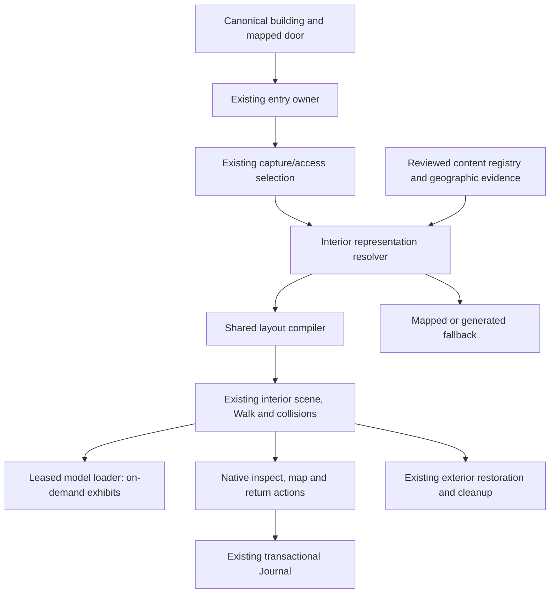

# Museum integration: existing system audit

October 12, 2026. Working branch `steven/visual-quality`, starting commit
`bb227354039e68eede1bc5d7c71778b086b50046`, with the retained release repairs
listed in `../release-review/2026-10-12/READINESS.md`. The owner added the museum
brief to the release scope. Production remains 5.5 at d877; no museum deployment.

Source inspection is not runtime verification. The completed diagnostic 93-gate sweep served
the immutable 31ab review build and cannot verify subsequent edits.

| Capability | Authoritative implementation | Current evidence / status |
| --- | --- | --- |
| Building identity and GIS footprint | `world/load-building-pass.js`, `building-provenance-model.js`, `building-metadata.js` | IMPLEMENTED_UNVERIFIED for museum association. General regional arrival passed in baseline sweep. Explicit metadata IDs and geometric matching are distinguishable. |
| Door and approach | `building-entry.js:resolveBuildingEntrySupport`, `world/building-facade-entrances.js` | VERIFIED_WORKING in baseline interior journey; specific museum door unverified. |
| POI tenants | `poi/semantic-authority.js`, `poi/lifecycle.js`, `poi/building-association.js` | PARTIAL: normalized tenants and published doors exist; nearest-safe-building fallback must not authenticate a named museum. No museum capability. |
| Interior selection | `interiors.js`, `interiors/mapped-data.js:resolveInteriorDefinitionForEntry` | PARTIAL: mapped source levels and generated fallback; no curated cultural-content registry. |
| Authorized captures | `reality-capture/interior-runtime.js`, `js/community-reality-capture-api.js` | IMPLEMENTED_UNVERIFIED for this release; authorization precedes asset URL. Private selection must retain precedence. No new scan rights granted by museum scope. |
| Room, door and stair compiler | `functions/interior-layout.mjs:normalizeLayout/assertPlayableLayout/compileLayout` | VERIFIED_WORKING in existing layout tests; museum layouts need new integration evidence. Same surfaces feed geometry and collision. |
| Walking, floors, return | `interiors/runtime.js:enterInteriorForSupport/clearActiveInterior/sampleInteriorWalkSurface`, `scene-builder.js`, existing Walk controller | VERIFIED_WORKING in baseline desktop/phone-width interior traversal. PARTIAL for in-flight entry cancellation: awaited definition has no current-request/world fence. |
| Asset loader and cache | `assets/model-asset-runtime.js:loadModelAsset`, `model-template-cache.js` | IMPLEMENTED_UNVERIFIED for new exhibits. Shared, leased templates, 64 MiB idle resource ceiling, instance disposal. Reuse this owner. |
| UI and touch | `interiors/runtime-ui.js`, shared contextual interaction and `screen-layout.js` | VERIFIED_WORKING for baseline entry/elevator/exit. Museum panels/maps absent. Existing Inter/Orbitron and --wx tokens are the design source. |
| Journal and persistence | `discovery/profile-store.js:recordExplorerEvent/getEventsById`, `explorer-events.js` | Existing transactional, idempotent story records. Museum records MISSING; use existing owner with no inventory, currency or field-observation claim. |
| Property and community | `real-estate` and `editable-world` owners, existing room/Firebase access rules | Museum display must never change ownership, tenancy, IDs, grants, room state or saves. No new writes to cloud rules/data are needed for public curated exhibits. |
| Provenance and import | model catalog, existing marine manifests, `scripts/reality-capture/glb-inspection.cjs` | PARTIAL: curated assets exist but no approved cultural-source importer, versioned content schema or two-source proof. |
| Performance and failure recovery | release gates, runtime diagnostics, owned browser cleanup | Baseline Earth exceeded 400 MiB geometry by 283,394 bytes; byte-color fix pending measurement. Museum repeat-entry, asset failure, slow loading, cancellation and resource bounds NOT STARTED. |

## Integration decisions

A curated interior is a representation of a canonical building, not another
building or world. Mapped interiors and permission-checked captures retain their
owners. Cultural identity requires an explicit stable source association and
footprint/entrance evidence. A representative gallery must say that its rooms
and displayed collection do not reconstruct or represent the real institution.

Only a current entry request can publish a scene. Leaving, switching worlds,
entering another building or cancelling must invalidate pending work. Models
attach to that active interior and dispose through their loader leases before
the parent scene is released. Scan or exhibit triangles never become collision.

## Initial source findings

The five suggested demonstration projects are not interchangeable asset
libraries. ThreeMuseum has MIT original code/art and separately credited
Smithsonian material; its 95 MB collection and newer Three.js must not be
imported wholesale. The nandana-das repository redirects to
`interactive-3d-virtual-museum` and exposes no repository license in inspected
metadata. Leo-shuanglin's MIT code wraps a mixture including NC/NC-SA assets;
that is not blanket permission to redistribute the collection. These are source
review findings, not claims that the demos were executed.

## Implementation checkpoint

The new reviewed content contract/resolver, gallery layout/fixtures/runtime/UI and bounded model transport are implemented locally. Fifty-seven focused tests pass across museum content, existing authored layout, curated assets, Backpack migration and environmental provider lease coverage. The full-game browser has confirmed the actual Overture building links to OSM way 336352958 and passes the geometric admission check. This is not yet complete entry/interaction/performance acceptance. A first navigation fixture used the inner anchor instead of the published outside approach; its failure was diagnosed and the fixture corrected without changing collision or door rules.

## Finished local gallery checkpoint

The first implementation checkpoint above is historical. The gallery now has a
source-informed front entrance hall and two connected exhibition rooms, finished
surfaces and door/ceiling joinery, bounded indoor lighting, three licensed
exhibits and licensed furniture. The final full-game journey passes 26 checks
including read/save/retry, mobile panel bounds, run/jump, exact exterior return,
reentry/resource cleanup and no page/GPU errors. Ten museum components plus the
eleven existing layout tests pass. See VERIFICATION and ARCHITECTURAL-REFERENCES
for scope, primary sources and the remaining accuracy/release limits.
