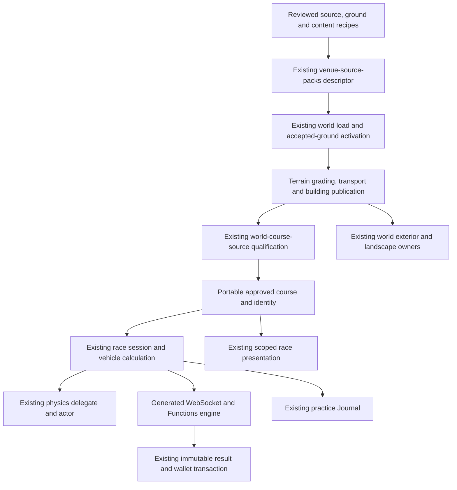

# Racing release architecture and execution plan

Updated October 30, 2026. This plan supersedes the historical sequence below.
The fixed scope is [FINISH_GOAL.md](FINISH_GOAL.md): all twelve layouts in
[RACE_VENUE_COVERAGE.md](RACE_VENUE_COVERAGE.md), shared real vehicles, garage,
upgrades, rivals/crews, multiplayer, Journal and trusted leaderboards. No purchase
or production deployment is part of implementation. This is a work order, not
venue acceptance.

## Baseline and actual dependencies

Preserve accepted vehicle/custody, progression, Journal, creator, city multiplayer
and trusted-result evidence. The real BMW M3 E46, BMW M3 E92 race car and Porsche
Carrera 4S use the existing vehicle owners. The E46 and Carrera are road models;
do not relabel them GT3 cars or replace them with generic prototypes.

Nordschleife, Silverstone and Daytona have integrated source/ground and completed
native practice journeys. Their complete presentation/pack acceptance remains
open. Nine layouts lack integrated source/ground packs. Zero packs have passed
all release gates. Reuse [SHARED_RACE_ACCEPTANCE.md](SHARED_RACE_ACCEPTANCE.md) and
[RELEASE_READINESS.md](RELEASE_READINESS.md); do not restart the investigation.

Source inspection identifies these constraints before further content work:

| Existing boundary | Current constraint | Required extension |
| --- | --- | --- |
| `scripts/lib/osm-venue-intake.mjs`, `venue-layout.js` | Keeps raceways and requires a closed loop | Reviewed open stages with preserved road tags, direction and exact endpoints |
| `venue-courses.js` | Circuit/oval events; closed-path start-line rotation | Open-stage assembly without closing or rotating the route |
| `world-course-source.js`, `course-rules.js` | Ordinary admission requires at least 6 m width | Source-bound rally envelope checks; ordinary city fences unchanged |
| `session-rules.js` | Pit branches explicitly reject non-oval sessions | Shared branch timing/contact separated from oval flags, drafting and penalties |
| `vehicle-controller.js` | Fixed surface profile and ground-fitted race pose | Validated segment grip and the existing portable vertical calculation |
| `road-race-delegate.js` | Forces `isAirborne=false` and `vy=0` | Adopt validated rally vertical state through the existing physics owner |
| `reviewed-venue-exteriors.js`, `course-furniture.js` | Venue dispatch and perimeter choices cover the first three venues | Reusable recipes selected through the existing pack descriptor |
| Generated service/Functions engines | Both consume bundled browser rules | Regenerate and compare both consumers for every shared contract change |

## Existing owners and dependency direction

| Concern | Owner and implementation boundary |
| --- | --- |
| Venue facts | Extend `RACING_VENUE_SOURCES` and `config/racing-venues/`. `venue-catalog.js` remains the reference/readiness view. No second runtime venue registry. |
| Ground and roads | `accepted-ground-activation.js`, district ground model, transport compiler and road contact index. Rendering, wheels and qualification share final published support. |
| Permanent scenery | Existing building semantics, `load-building-pass.js`, `reviewed-venue-exteriors.js`, static batching, collision and world collection lifetime. |
| Event equipment | `presentation.js`, `course-markings.js`, `course-furniture.js`; resources retire with the race. |
| Motion and time | Existing planar/vertical functions, `vehicle-controller.js`, `session-rules.js`, simulation clock and `road-race-delegate.js`. Retain accepted pose interpolation. No competing clock, smoother or actor writer. |
| Vehicles | Existing catalogue, model leases, garage, condition, upgrades, home assignment and ordinary/race custody handoff. |
| Records and network | Existing Auth/room admission, race authority, canonical publication, immutable result transaction, Journal and Rankings. No additional identity, wallet, room list or score store. |
| Cancellation | Existing world/environment generation, abort signals, race current-owner checks and resource leases. Late work cannot publish into a replacement world. |

Location-based play, optional continuous exploration, buildings, travel modes,
Ocean, Space, saves, mobile controls, VR and platform adapters retain their
current entry paths and owners. Venue preparation uses the existing world loader.

## Pack contract and publication order

Extend existing descriptor fields with bounded validated facts where required:
layout kind/discipline, ordered source membership/endpoints, pinned source/ground/
deck/pavement digests, surface conditions, timing/sector/pit references and
presentation recipes. Keep measured values distinct from authored game detail.

Rally intake preserves real highway/access/surface tags. Closed-event permission
is explicit and limited to reviewed source membership. It cannot globally relax
city access, width, grade, water or structure guards. A narrow route must support
its eligible chassis with explicit clearance, not merely pass a smaller number.

Publication has one order:

1. Validate every required source/ground artifact and full-route coverage.
2. Normalize source facts and reserve uniquely matched building replacements
   before ordinary batching. Apply reviewed fallback dimensions through shared
   semantics consumed by near and far representations. Preserve explicit heights,
   levels, entrances and unrelated buildings.
3. Compile profiles and graph joins; grade terrain; publish final road triangles
   through the existing transport owner.
4. Publish permanent structures/colliders after final support exists, using the
   existing deferred transport-dependent publication phase.
5. Qualify the full route from published support and form the portable course.
   Missing spans, unsupported wheels and invalid crossings reject admission.
6. Prepare matching vehicles/event presentation and adopt the current session's
   controls through the existing custody handoff.

Abort/replacement fences apply at every asynchronous boundary. Completion, leave,
account change and world change release only the current session's resources.
Permanent scenery belongs to the world; temporary equipment belongs to the race.

## Shared discipline implementation

**Circuit/oval pits:** retain `pit-lane-rules.js` for branch geometry, pavement
union and timing projection. Refactor session branch progress to serve both
closed disciplines. Rolling formation, apron restrictions, drafting and oval
flags remain oval policy. Circuit starts, sector/cut validity, pit speed and merge
rules require explicit shared policy. Preserve ordered gates, alternate-path
finishes, lap wrapping and server elapsed time. A pit cannot skip progress or
award a lap early. Retain Daytona fixtures and its accepted lap unless the actual
course or demonstrated behavior changes.

**Rally stages:** exact dated direction, start/finish, ordered splits, staggered
starts and bounded game-authored pace notes. No closed-loop rotation or
simultaneous-grid semantics. Show notes through existing race HUD/VR presentation.

Use one versioned asphalt/gravel/snow-ice surface contract. The portable step
reads segment conditions; textures and arbitrary client settings cannot choose
competitive grip. Reuse `physics/road-vehicle-airborne.js` for launch, gravity and
landing. Extend race snapshots, network frames and actor adoption together with
vertical velocity, airborne state and required prior support. Both generated
engines, prediction/reconciliation, camera presentation and Journal configuration
must agree. The delegate must not overwrite valid flight. Ordinary circuit/oval
planar behavior remains unchanged.

Recovery is a session/server command to a validated already-reached position,
with a documented time penalty and neutral controls. It cannot advance a split,
rewind authority time, mint a clean finish or repair condition for free. Known
flight differs from unavailable support; missing/unloaded terrain still fails.
Landing/recovery damage uses the existing condition authority and condition
handback. Admission checks the longest eligible chassis through bends and
structures, including its swept envelope, rather than checking centreline width
alone.

New handling/timing contracts receive separate `record-rules.js` versions. Retain
old Journal readers and unchanged ordinary class identities. Rebuild through
`scripts/build-racing-service.mjs`; require `--check` parity for WebSocket and
Functions consumers. No hand edits to generated engines.

## Presentation shared across all twelve packs

Build reusable recipes for repeated pit modules, stand sections, rails/walls,
catch fences, kerbs, runoff, braking boards and landscape bands. Select them
through existing pack/publication owners. Unique landmarks may retain a specific
factory; share repeated material, foundation, batching and disposal behavior.

Give every pack a complete first presentation pass before another optional
refinement pass on one venue. Each covers surface character, edges, pits/start
facilities, barriers, relevant landmarks and surrounding landscape. Circuit,
oval and rally content have separate requirements. Generic asphalt and scattered
props do not pass visual acceptance.

Construction geometry follows final surface triangles, including bank/apron and
kerb creases. Use shared texture leases, metre scale, bounded batches and existing
LOD/distance visibility. No per-frame rebuilding or second height sampler.
Physical obstacles must agree with approved collision/support facts; cosmetic
detail alone does not create a new physics class.

City racing retains the selected location's mapped roads, buildings and landscape.
Shared material/equipment improvements must also fit that context. Do not create
an isolated generic city race scene or start an unrelated worldwide redesign.
Research images do not become game textures without reusable rights.

## Dependency-ordered execution and completion gates

B1 source/path preparation is implemented: exact open-stage intake, versioned
interval/width policy, directed path reconstruction and generated-engine parity.
Controlled source/browser checks pass; actual stage course creation and world
adoption remain explicitly unavailable pending B3. This is not a playable pack.

B2 shared circuit pit support is implemented with separate width review,
standing-start policy, ordinary published support, speed/merge rules, prediction
and record class. Controlled full-branch and real-model browser checks pass.
Native per-circuit pit inputs, sectors/cuts and pack acceptance remain open.

| Work package | Depends on | Concrete completion gate |
| --- | --- | --- |
| A. Baseline and architecture | Existing source/evidence | Preserve pending work; identify shared owners, contracts and accepted evidence. This plan ends the architecture lookup phase. |
| B1. Open-stage source/course contract | A | Preserved public-road tags, exact ordered open endpoints, scoped narrow-road admission and deterministic browser/service/Functions course identity; closed-loop regressions pass. |
| B2. Circuit pit/session policy | A | Shared branch timing/contact with separate discipline policy; finish/lap/merge regressions and generated parity pass. |
| B3. Rally motion/session contract | B1 | Segment grip, shared vertical frames, staggered clocks, splits, recovery and record identity agree in all consumers; negative authority cases pass. |
| C. Remaining geographic packs | A; B1 for rally assembly | All nine exact source/layout/ground/deck/pavement/pit inputs with rights, length reconciliation and coverage. Unavailable data is recorded, never replaced by invented elevations. |
| D. World integration | B + C | Every route qualifies; first native circuit pit and rally flight/recovery journeys pass before detailed art refinement. |
| E. Complete presentation | D and shared recipe builders | Driving views at start/pits, critical bend/bank/crest and recognisable landmark/context for all twelve. Shared defects repaired at their owner. |
| F. Product acceptance | D + E | Every new complete lap/stage, AI, eligible chassis clearance, ordinary controls, leave/replay, Journal and changed multiplayer/result classes pass. Reuse unchanged accepted laps. |
| G. Coordinated release candidate | F | Matching frontend/service/Functions/index artifacts, licensing, public-source/security checks, affected distribution checks, identity and acceptance report. |

Only one heavyweight process runs at a time. Shared capability work completes
once and serves all packs. A blocked external source remains visible while other
ready inputs advance; it does not justify returning to optional Daytona polish.

### First bounded implementation hour

The target is a concrete shared extension with passing integration evidence,
not completion of nine new geographic packs plus twelve-pack acceptance in one
hour. The prior broad one-hour work allocation is superseded by this dependency
order.

| Time from implementation start | Output target |
| --- | --- |
| 0–10 minutes | Translate B1 into the existing source/layout/course interfaces and explicit compatibility cases; retain the three accepted closed-layout outputs. No new general investigation or venue art. |
| 10–35 minutes | Implement the bounded open-stage source/course path and scoped admission policy through existing owners. Preserve tags, endpoints, direction and ordinary closed-course behavior. |
| 35–50 minutes | Focused positive/negative cases and generated WebSocket/Functions parity. Check that incomplete or forged stage facts cannot grant admission. No runtime rally enablement before B3. |
| 50–60 minutes | Record exact completed changes and checks, remaining dependencies and source-intake readiness for all nine missing packs. Address the first demonstrated contract failure; no optional art loop or blanket historical retest. |

If a contract fails, report its exact failing gate and remaining work rather than
marking the milestone complete. Following implementation windows are B2/B3 and
C, then D through G above. Estimate them from completed contract and source
intake results; do not invent a full-release deadline before those inputs exist.

| Venue work queue | Reuse | Remaining work |
| --- | --- | --- |
| Nordschleife T13, Silverstone GP | Accepted source/ground, full laps, steady-driving repair | Complete presentation, circuit pit/sector/cut paths and affected final gates |
| Daytona tri-oval | Accepted source/ground, oval/pit rules and full pit lap | Preserve pending checkpoint; bounded remaining presentation and affected final gates |
| Indianapolis, Talladega, Bristol | USGS window/datum pipeline and banked oval/pit rules | Three distinct exact source/ground/profile/pit packs, Bristol concrete, scenery and first native acceptance each |
| Spa GP, Monza GP | Circuit compiler, reviewed decks/kerbs, circuit pit policy | Exact geographic packs, relief/landmarks, presentation and first native acceptance each |
| Turini 2026, Ouninpohja 2025, Fafe 2026, Umeå 2026 | B1/B3 shared stage contracts | Four dated geographic/condition packs, pace notes, landscape and first native stage acceptance each |

Reuse the machinery. Do not reuse invented common heights, layouts or conditions
in place of each venue's evidence.

## Finite acceptance and production handoff

Track six gates per venue: source/ground; published support; discipline;
presentation; gameplay/persistence; exact-build performance/release. Each pass
names its source/build and scope. Source checks, controlled integration, native
gameplay and live service evidence stay distinct; catalogue flags cannot pass
these gates.

Retain accepted garage, custody, city multiplayer, awards, creator, career and
Journal checks. Recheck only dependencies changed by this work. New course and
physics identities require canonical storage/reconstruction and affected
authenticated major-venue paths. Verify new discipline classes through real
authority/reconnect/result recovery, retaining obsolete-lease, duplicate-result
and fabricated-input rejection.

After content stabilises, measure actual moving scenes against existing desktop
rate and hitch budgets. Include the largest route and heaviest completed scene;
one measurement covers both only if it actually represents both. Average FPS
alone cannot pass pacing. Verify normal keyboard/touch and affected body/camera
continuity. Label emulation/controlled VR accurately. Missing physical Apple or
headset hardware does not block software implementation or become a fake pass.

Build one coordinated candidate after acceptance. Align existing release-scope
evidence with this fixed goal; the legacy full release script includes a physical
host prerequisite and historical matrices and must not be blindly restarted.
Preserve real gates and carry accepted evidence only where dependencies remain
unchanged. Do not weaken checks to obtain a green release script.

The handoff contains exact revision/artifact digests, the twelve-pack matrix,
changed server/index requirements, tested journeys, licences, performance and
unverified physical-device claims. Production-ready requires every mandatory
gate. Preparing the candidate does not deploy unfinished work.

## Historical implementation sequence — superseded

Evidence date: October 28, 2026. Baseline `7da846f`; current working-source improvements are distinguished from unimplemented racing. No production deployment or purchase.

1. Audit source and owner boundaries;preserve baseline/evidence.
2. Repair ordinary vehicle collection/selection,custody and upgrade retention using current wallet/player records. Models must match the selected catalog and stage before handoff.
3. Repair low-speed damage,retained/cached damage presentation,traffic footprint/following/yielding and unsupported underwater aircraft starts. Keep bridges/tunnels and aircraft/maritime/interior admission.
4. Verify changed journeys and account/receipt integrity;commit locally. No automatic production deployment.
5. Present three researched career alternatives and working UI examples. Owner selection is required by the brief before committing career pacing/unlocks.
6. Prototype race-grade road validation and a low-latency adapter to existing room identity/control plane;prove one credible AI and authoritative timing. Current2500ms presence cannot simply be called competitive racing.
7. Complete the16-step integrated slice,including custom course andtwoauthenticatedplayers. Only then expand the selected career and disciplines.

Regular vehicles are shared infrastructure: racing consumes their catalog,physics,ownedbuild,damage,controller andsupport. Race sessions add rules/eligibility and temporarily own relevant controls;they do not create another wallet,garage or unbounded scheduler. Future engine consumers should use portable rules and world facts through adapters.

Owner selected Open rivals and racing crews on October28,2026. The career-selection checkpoint is complete; proceed with the integrated slice and that career, preserving the documented authority/performance gates. Do not claim all racing is complete at that checkpoint. See RELEASE_READINESS and VERTICAL_SLICE_RESULTS for explicit unrun requirements.

## Balanced major venues and collector/skill integration

The owner additionally selected a balanced initial release across permanent
circuits, stock-car ovals and rally stages. The initial reference register has
four exact layouts per group, including the full Nordschleife. See
`RACE_VENUE_COVERAGE.md` for facts, asset suitability, source rights and admission
requirements. A reference row is not completion; none of these major venue packs
is yet playable.

The finite release end includes the 16-step integrated slice above, selected
rivals/crew functionality, meaningful garage/character progression, and complete
accepted venue packs across all three groups. Broader world-track coverage must
then use a dated layout inventory; do not promise literal universal coverage
from a list of famous names. Defaults remain selected-location exploration and
optional racing/continuous exploration.

Collector integration reads the existing owned vehicles, condition and home
assignment. Race practice commits Ground Vehicles proficiency through the
existing Journal character transaction. Clean finish and three-lap consistency
feedback use actual session contacts/penalties/lap times. Personal records are
car/build/condition/physics-version specific; changing those does not reset the
existing per-course practice-XP repetition limit. No new currency, character,
progress store or scheduler is introduced.

Continue with the authenticated authority and durable result slice before
extending venue residency/rules. Keep the venue data/presentation intake and
cross-discipline acceptance visible in the same ledger so neither a successful
city practice race nor a researched circuit catalogue is called a whole product.
